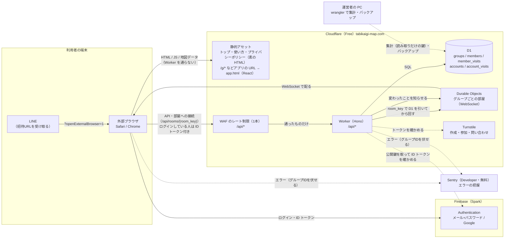

# システム構成

状態：下書き（2026-10-19：画面のテストは計算だけにすると決めた。2026-10-19：lint・Dependabot を入れ、GitHub の設定（ルールセット）を書き、「開発環境」を実際の設定に合わせた。2026-10-16：開発運用を決め、「環境」と「開発環境」にデプロイ・ステージング・lint・Dependabot を書いた。2026-10-16：OGP の文言と画像を決めた。2026-10-15：`/review-docs` を受けて、「ログに残るもの」のグループIDの扱いを実際の API（URL のパスに入れる）に合わせ、部屋が配らないものに管理できる人の変更と退会を足した。2026-10-13：管理の操作の API を作った `access-reviewer` の指摘で、名前の変更を「使い切られうる API」に足した。2026-10-13：API を作った `access-reviewer` の指摘で、目印のヘッダー（よそのサイトから読ませない）を「無料枠を使い切られないために」に足し、Sentry で消す URL に `/api/groups/` を足した。2026-10-12：開発環境を用意して、Node.js の版とリポジトリの構成（1つの `package.json`）を決め、テストの道具の名前を `@cloudflare/vitest-plugin` に直した。2026-10-12：`/review-docs`（24件）を受けて、Mermaid の構成図を清書にそろえ（WAF、Turnstile、運営者の PC、部屋への接続）、部屋の URL を `/api/rooms/{room_key}` にし、429 の扱い、Sentry に送る前に消すもの・作る前に確かめること・DSN と CPU の注意、集計の鍵、問い合わせの確かめ方と保存期間、Durable Objects の枠を直した。2026-10-12：Q-025・Q-026・Q-027・Q-031 を推奨案で決めて、「運用」、「無料枠を使い切られないために」、「エラーの送り方」、ログに残るもの、使うサービス（WAF のレート制限、Sentry）を書いた。構成図の清書（draw.io）を足した。2026-10-12：Q-016・Q-017 の `/review-docs`（18件）を受けて、`noindex` と `Referrer-Policy: no-referrer` を付けるパスを並べた。2026-10-12：Q-016 を決めて、アプリの画面の URL を `app.html` へのリライトに足した。2026-10-11：Q-020 の `/review-docs`（21件）を受けて、メンバーとグループの削除も部屋から「取り直して」を配ることにし、503 の理由の分け方を足した。2026-10-10：[ADR 0003](../adr/0003-backend-selection.md) が案 C に決まったので、Firebase 一式の版から書き直した。元の版は git の履歴にある。画面の作り方は [ADR 0004](../adr/0004-frontend-react-typescript.md)。システム構成図の清書（draw.io）は roadmap の Phase 1 で作る）

## 構成図



清書（draw.io）：[architecture.drawio.svg](architecture.drawio.svg)（正本はこの Mermaid）

- 画面は静的なファイルとして Cloudflare から配る。**`/api/*` だけを Worker が受ける**（`run_worker_first`。部屋への接続も `/api/rooms/{room_key}` で、`/api/*` の中に置く：Q-031）。招待URL `/g/*` とアプリの画面の URL（`/new`、`/account`、`/login`、`/groups`、`/me`、`/contact`。[screens.md](screens.md) の「トップと URL」）は `_redirects` の 200 リライトで `app.html` を返し、Worker を通らない（Worker の枠が尽きても画面は出る。2026-10-05 に本番で確認：[ADR 0003](../adr/0003-backend-selection.md) の決定の基準1）
- データの正本は D1 の1か所。読み書きはすべて API を通す。画面から D1 に直接は触れない。データの形は [data-model.md](data-model.md)
- **アクセス制御（NFR-006）は API とデータベースの制約で行う**。どこで何を守るかは [data-model.md](data-model.md) の「保存先で守るもの」
- リアルタイム（NFR-003）：API が D1 に書けたら、グループの部屋に知らせ、部屋が開いている画面に WebSocket で配る。部屋はデータを持たない（[ADR 0003](../adr/0003-backend-selection.md) の「リアルタイムの共有」）
- 地図の形（47都道府県の SVG パス）は、ビルド時に画面へ埋め込む静的データ（`tools/paths.json`）。DB には入れない

## 使うサービス

| サービス | 役割 | 無料枠と、超えたとき |
|---|---|---|
| Cloudflare 静的アセット | 画面の配信、`/g/*` のリライト、`_headers` で `noindex` | 無料・無制限。Worker の回数に数えない（2026-10-05 に本番で確認） |
| Cloudflare Workers | API（Hono） | 1日10万リクエスト、1回の CPU 10ms。超えたらエラーで止まり、日本時間9時に戻る |
| Cloudflare D1 | データ（SQLite） | 1日に読み取り500万行・書き込み10万行、1データベース500MB、1回の呼び出しで SQL 50本まで。超えたらエラーで止まり、日本時間9時に戻る |
| Cloudflare Durable Objects | リアルタイムの部屋 | Free は SQLite 版だけ。1日10万リクエスト（接続が1、WebSocket の受信は20通で1、送信は数えない）と、動いている時間 1日13,000 GB 秒。眠れる書き方（WebSocket Hibernation）にして、つながっているだけの間は時間を使わないようにする前提。超えた種類の操作がエラーで止まり、日本時間9時に戻る（要確認：GB 秒の数え方と眠れる書き方の効き方は Phase 2 で測る） |
| Firebase Authentication（Spark） | メール＋パスワード、Google。確認メールとパスワードの再設定のメール | 5万 MAU（公式の制限のページには MAU の上限が書かれていない：要確認）。確認メール 1,000通/日、パスワードの再設定 150通/日 |
| Cloudflare Turnstile | ボット対策（グループの作成、参加、問い合わせ） | 無料・回数無制限。ウィジェットは20個まで。検証（siteverify）は API の中で1回呼ぶだけで、Workers の回数は増えない |
| Cloudflare WAF のレート制限 | `/api/*` への連続アクセスを止める（Q-031） | Free で1本（IP ごと、10秒の窓、止めるのも10秒）。止めたアクセスは Worker に届かないので、Workers の回数を使わない |
| Sentry（Developer） | 画面と API のエラーの把握（NFR-013、Q-027） | 無料、1人、月5,000件。超えたら受け付けなくなる（請求は来ない）。有料プランと従量課金（Pay-as-you-go）は有効にしない |
| Cloudflare Registrar | ドメイン `tabikaigi-map.com`（最初から使い、変えない：NFR-020） | 年額の固定費（2027-10-04 まで、自動更新） |

どれも Free のまま使い、有料プランには上げない。Cloudflare で触らない製品と操作（R2 の有効化など）は [ADR 0003](../adr/0003-backend-selection.md) の「C で Cloudflare 側を守る決まり」。

出典：[ADR 0003](../adr/0003-backend-selection.md) の「出典」、https://developers.cloudflare.com/durable-objects/platform/pricing/ 、https://developers.cloudflare.com/turnstile/plans/ 、https://developers.cloudflare.com/waf/rate-limiting-rules/ 、https://sentry.io/pricing/ 、https://docs.sentry.io/pricing/quotas/ 、https://developers.cloudflare.com/workers/platform/pricing/ 、https://developers.cloudflare.com/d1/platform/pricing/ 、https://developers.cloudflare.com/d1/platform/limits/ 、https://developers.cloudflare.com/durable-objects/platform/pricing/ 、https://firebase.google.com/docs/auth/limits

### 無料枠を超えたとき（NFR-009・NFR-012）

API の枠（Workers・D1）が尽きると、その日は「行った」を保存できなくなる。画面は API の応答が「枠切れ」の理由を付けた JSON の 503 でも、JSON でない応答（Cloudflare のエラー画面）でも「いまは使えない」を出し（「一時的な失敗」の 503 は「もう一度お試しください」。[screens](screens.md) の「知らせ」）、付け外しを送らない（2026-10-10 にローカルで確認：[ADR 0003](../adr/0003-backend-selection.md) の決定の基準3）。画面そのもの（静的アセット）は出続ける。

Durable Objects の枠が尽きたら、リアルタイムだけが止まり、開き直したときに反映される形に戻る（NFR-003）。

Workers の枠が尽きると、`run_worker_first` に当たる `/api/*` は Cloudflare の 429 になり、静的アセットには切り替わらない。WAF のレート制限で止められたときも 429 になる。画面は、429 を「少し待ってもう一度」（付け外しは元に戻す）として扱い、続けて429が返るときだけ「いまは使えない」を出す。それ以外の JSON でない応答は枠切れとみなす。WAF の応答を Free で JSON に変えられるか、Workers の枠切れの 429 と見分けられるか（本文や `Retry-After`）は Phase 2 で確かめる（要確認。2026-10-12：`/review-docs` #2）。D1 の枠が尽きたときは、Cloudflare から運営者にメールが届く（2026-09-01 から Free の上限で実際に止まるようになった）。出典：https://developers.cloudflare.com/workers/static-assets/billing-and-limitations/ 、https://developers.cloudflare.com/changelog/post/2026-09-01-d1-free-tier-limit-enforcement/

### 部屋が配るもの（NFR-003）

部屋は、API が D1 に書けた後に知らせを受けて、そのグループの画面を開いている全員に配る。配るのは次の3つだけ（[ADR 0003](../adr/0003-backend-selection.md) の「リアルタイムの共有」）。

| 種類 | 中身 | いつ |
|---|---|---|
| 「行った」の付け外し | メンバーの番号、県の番号、付けたか外したか | ログインなしのメンバーの付け外し。ログインしている人の付け外しは、紐づいたメンバーがいる全グループの部屋に、それぞれのグループでのメンバーの番号を付けて配る |
| 取り直して | なし | メンバーの削除、グループの削除（ほかの人の画面が消されたことに気づくため。2026-10-11：Q-020）。紐づけで、そのメンバーの「行った」がアカウントのものに入れ替わったとき |
| （配らない） | — | 参加、退出、名前の変更、グループ名の変更、管理できる人の変更、退会（退会で消えたメンバーは、ほかの人がグループを開き直したときに消える。2026-10-15）。画面は、知らないメンバーの変更が届いたときと、画面に戻ったときに全体を取り直す |

画面が受け取った「取り直して」と、知らないメンバーの変更は、どちらもグループを読み直す（読み取りは1回分）。

## 運用

運営者1人で回せる形にする（NFR-014）。ふだん確かめる場所は Cloudflare のダッシュボード、Firebase のコンソール（どちらもサービスのコンソール）、運営者の PC での集計の3つ。Sentry はメールが来たときだけ開く。D1 の上限のメールと Sentry のメールが「何かあったときの知らせ」（NFR-014）。

| 何を | どうやって | 要件・未決 |
|---|---|---|
| バックアップ | 新しい版を出す前に `wrangler d1 export` で全データを手元に書き出す。書き出しの間はほかの読み書きが止まる（公式：https://developers.cloudflare.com/d1/best-practices/import-export-data/ ）ので、使われない時間に行う。直近の1つだけ残す。手順は [deploy](deploy.md) | NFR-017 |
| 消したデータの残り方 | D1 の Time Travel は常に有効で、消したデータも7日間は戻せる状態で残る（Free。復元は10分に10回まで）。プライバシーポリシーの保存期間に書く | NFR-008 |
| 利用状況 | 運営者の PC から、D1 の読み取りだけ・期限付きの API トークンで `wrangler d1 execute --remote` を動かし、集計の SQL を流す（`wrangler login` の広い権限や、バックアップ用の鍵は使わない。読み取りだけの権限を作れるかは要確認。2026-10-12：`/review-docs` #16）（グループ数、メンバー数をログインあり・なし別、直近30日に開かれたグループ数）。「開かれた」は、グループを開く API が `groups.last_opened_on` を日付で残したもの（[data-model](data-model.md)）。集計の SQL も D1 の読み取りの回数に数える（全件を読んでも数千行で、1日の枠の1％未満）。外部のアクセス解析は使わない（Q-025） | NFR-010 |
| 使用量 | 週1回、Cloudflare のダッシュボード（Workers・D1・Durable Objects の Metrics）と Firebase のコンソール（サービスのコンソール）を見る。どれかが1日の上限の5割を超えた日があったら、自動の知らせ（下）を作るか、構成を考え直す。D1 は上限に達すると Cloudflare からメールが届く。上限に近づいたことを自動で知らせる仕組みは MVP では作らない（Q-026） | NFR-011 |
| エラー | 画面と API のエラーは Sentry（Developer・無料）に送り、新しいエラーはメールで知らせてもらう。送る前にグループIDを伏せ、利用者の情報（IP など）を送らない（下の「エラーの送り方」）。Workers Logs は、アクセスごとの自動の記録（`invocation_logs`）を切り、自分で書いたログだけを残す（Q-027） | NFR-013 |
| 使い切られる対策 | 下の「無料枠を使い切られないために」（Q-031） | NFR-004・NFR-012 |
| 運営者用の管理画面（MVP の次） | 運営者の PC で動かす画面。D1 の集計と、GraphQL Analytics API の使用量（読み取りだけ・期限付きのトークン）を1画面に出す。インターネットには置かない（Q-030） | NFR-014 |
| 問い合わせ | アプリの中のフォーム（API＋D1＋Turnstile）。表の形は Phase 2。新しい問い合わせは、週1回の確認で、運営者の PC から集計と一緒に見る（NFR-018 の「1か月以内」に間に合う）。返事は、このアプリ用に作ったメールアドレス（Gmail など）から手で送る。返信先と本文は、対応が済んでから3か月で消す（2026-10-12：`/review-docs` #5） | NFR-018 |
| D1 の置き場所 | 作るときにアジアを指定する（後から変えられない：要確認） | NFR-016 |

出典：https://developers.cloudflare.com/d1/reference/time-travel/ 、https://developers.cloudflare.com/d1/platform/limits/ 、[ADR 0003](../adr/0003-backend-selection.md) の「運用」

### 無料枠を使い切られないために（Q-031）

2026-10-12 に決めた（ユーザーが「7. の残りを一気に進めて」と頼んだので、推奨案で決めた。見直すときは open-questions に理由を足して変える）。ふだんの使い方（1日500回開かれる：NFR-015）では、Workers は1日の上限の1割以下の見込みなので、守るのは、悪意のある人や不具合が枠を使い切る場面。

| 手立て | 中身 | 守るもの |
|---|---|---|
| 画面は Worker を通さない | `run_worker_first` は `/api/*` だけ（部屋への接続も `/api/rooms/{room_key}`）。互換日付（`compatibility_date`）を 2025-04-01 以降にし、ページの移動はアセットの側で返す。ファイルがない URL は `not_found_handling = "404-page"` で静的な `404.html` を返す（`_redirects` の 200 リライトと合わせた動きは Phase 2 で確かめる：要確認） | Workers の回数 |
| `/api/*` のレート制限 | Cloudflare WAF のレート制限のルール1本（Free）。IP ごとに10秒で一定の回数を超えたら10秒止める。回数は、会議で1人が続けて「行った」を押す速さより十分多くし、Phase 2 で決める（仮に10秒で50回） | Workers・D1・Durable Objects の回数 |
| Turnstile | グループの作成、参加、問い合わせの API で確かめる（いまのまま）。地図を開くたびには付けない | D1 の書き込み |
| 部屋への接続の確かめ | 部屋の URL は `/api/rooms/{room_key}`（グループIDの SHA-256。WAF のレート制限も効く）。Worker が D1 の `groups.room_key`（`UNIQUE`）で引いてグループがあることを確かめてから Durable Objects に回す（読み取り1行程度。[data-model](data-model.md)）。作るのはリアルタイムと同じ Phase 2（2026-10-12：`/review-docs` #3） | Durable Objects の回数 |
| つなぎ直しの間隔 | だんだん長くする（最大60秒。[screens](screens.md) の「知らせ」） | Durable Objects の回数 |
| 目印のヘッダー | 画面は API に `X-Tabikaigi: 1` を必ず付け、付いていなければ D1 を読まずに 400 にする（2026-10-13）。よそのサイトに `` を置かれると、訪れた人のブラウザから IP を散らしてグループを開かせられ、IP ごとのレート制限が効かない。独自のヘッダーはブラウザが勝手に付けず、付けるには事前の確認（preflight）が要るが、その応答も D1 を読まない | D1 の読み取り |
| `workers.dev` を切る | 独自ドメインだけで受ける（`workers.dev` の URL も同じ枠を使うため。要確認） | Workers の回数 |

それでも、Turnstile のない API（グループを開く、「行った」の付け外し）を繰り返し呼ばれると、無料枠は尽きうる（2026-10-13：`access-reviewer` #1・#2 の見積もり。どれも仮定の数字で、本物の D1 の `meta.rows_read`・`rows_written` で確かめる〔未〕）：
- 読み取り：20人が全員47県を付けたグループを1回開くと、約1,000行を読む。1日500万行なので約5,000回で尽き、レート制限の仮の値（10秒で50回）なら1つの IP から約17分
- 書き込み：付けて外すのを繰り返すと1回で約2行。1日10万行なので約5万回で尽き、1つの IP から約3時間、10個の IP なら約17分
- 読み取り（グループ一覧）：ログインが要るが Turnstile はない。人数を数えるので、10グループ（各20人）に入った人なら1回で約220行を読む。1つの IP から約76分で尽きる見込みで、グループを開く API（約17分）より軽い（2026-10-15：`access-reviewer`。本物の D1 の `rows_read` で確かめる〔未〕）
- 書き込み（名前の変更）：グループ名の変更はログインも Turnstile も要らず、2つの名前を交互に送ると1回で約1行（1つの IP から約5.5時間）。メンバーの名前の変更はログインが要るが、索引も書き換えるので1回で約3行（約2時間）。同じ名前を繰り返し送っても書かないようにした（2026-10-13：`access-reviewer` #3）

Phase 2 で、レート制限の回数を決めるときにこの数字を測り直す。読み取りが足りなければ、グループを開いたときの応答を Worker のキャッシュ（Cache API。無料で D1 を使わない）に数秒だけ取っておく案を試す（書いたら消す。ほかのデータセンターのキャッシュは消せないので、数秒は古い地図が見えることを受け入れるかを決める）。requirements の「分かっている限界」（使い切られると翌日まで止まる）は変わらない。

入れないもの：Bot Fight Mode（ドメイン全体に効き、例外を作れない。API や WebSocket を止めることがあるため。困ったら試してから考える）、Workers の Rate Limiting の仕組み（Worker が起動した後に数えるので、Workers の回数は減らない）。

Firebase のメール（確認メール1日1,000通、パスワードの再設定1日150通）は、画面から Firebase に直接頼むので、Turnstile やレート制限で守れない。他人が再設定のメールを頼み続けると、その日はほかの人が再設定できなくなる（requirements の「分かっている限界」）。Firebase の不正利用の守りに任せる（要確認）。メールのリンクでログインする方法（1日5通）は使わない。

出典：https://developers.cloudflare.com/workers/static-assets/routing/worker-script/ 、https://developers.cloudflare.com/workers/static-assets/routing/single-page-application/ 、https://developers.cloudflare.com/durable-objects/best-practices/websockets/ 、https://developers.cloudflare.com/bots/get-started/bot-fight-mode/ 、https://firebase.google.com/docs/auth/limits

### エラーの送り方（Q-027）

2026-10-12 に決めた（ユーザーが「7. の残りを一気に進めて」と頼んだので、推奨案で決めた。見直すときは open-questions に理由を足して変える）。

- 画面（React）と Worker の両方に Sentry の SDK（Worker は `@sentry/cloudflare`）を入れる
- 利用者の情報を送らない設定にする（`dataCollection` で利用者の情報を切る。Sentry のプロジェクト設定で IP を保存しない。IP から取る場所も消すルールを足す）
- `beforeSend` で、URL、パンくず（直前の操作の記録。fetch の URL を含む）、`transaction` の名前、メッセージの中の `/g/` と `/api/groups/` に続く22文字を `[id]` に、`/api/rooms/` に続く値を `[room]` に置き換えてから送る（API は URL にグループIDを入れる：[api](api.md)。2026-10-13 に `/api/groups/` を足した）。要求（`event.request`）のヘッダーと中身は丸ごと消す（`Authorization` には ID トークンが入るため。2026-10-12：`/review-docs` #4）。名前、メールアドレス、行った都道府県はエラーに入れない（NFR-013）
- 送る割合は全部（数が少ないため）。月5,000件を超えたら、その月は送れなくなるだけ
- 有料プラン、従量課金、試用（トライアル）は有効にしない。アカウントを作るときにクレジットカードを求められたら、作らずに相談する（要確認）。そのときの代わりは、画面のエラーを自分の API に送って Workers Logs に残す形（通知はなく、見に行く）
- 送った中身から本当にグループID、ID トークン、要求のヘッダーと中身が消えているかは、Phase 2 で実際に送って確かめる（要確認）
- アカウントを作る前に確かめる：登録すると試用（Business）が自動で始まらないか、始まったら期限の後に無料のプランに戻るか。組織の名前（`xxx.sentry.io`）に本名やメールアドレスが自動で使われないか（[learnings](../learnings/2026-10-05-check-service-defaults.md)）。データの置き場所（米国か EU か。組織を作るときに選ぶ）と保存期間を privacy に書く
- 画面に埋め込む DSN（送り先の鍵）は誰でも見られるので、偽のエラーを大量に送られると、その月はエラーが見えなくなる（請求は来ない）。同じエラーは画面の側でまとめて送り、DSN ごとの回数の制限が無料で使えれば付ける（要確認）。受け入れる限界として requirements に書いた
- Worker に SDK を入れると CPU が増える（試作で最大 7ms、Free の上限は 10ms）。Phase 2 で、入れた状態の CPU 時間を測る（要確認）

Workers Logs の設定（`wrangler.jsonc` の `observability`）：`"enabled": true`、`"head_sampling_rate": 1`、`"logs": { "invocation_logs": false }`。アクセスごとの自動の記録（URL、IP アドレス、おおよその場所）を残さず、自分で書いたログ（`console.error` など）だけを残す。切ったときに IP などが本当に残らないか、自分のログは残るかは Phase 2 で確かめる（要確認）。Workers Logs の Free は、2026-12-01 から1日0.5GB・7日保存に変わる（それまでは1日20万件・3日保存。超えたら取り込みが止まるだけで請求は来ない）。

出典：https://docs.sentry.io/platforms/javascript/guides/cloudflare/configuration/options/ 、https://docs.sentry.io/security-legal-pii/scrubbing/server-side-scrubbing/ 、https://developers.cloudflare.com/workers/observability/logs/workers-logs/ 、https://developers.cloudflare.com/observability/pricing/

## 認証の方針

- **ログインする人だけ** Firebase Authentication を使う。ログインなしの人は匿名ログインもせず、証明書なしで API を使う（ADR 0003。理由：案 C ではログインなしの人の `uid` を持たないので、匿名ログインの利点がない）
- ログインしている人は、API を呼ぶたびに ID トークン（Firebase の証明書）を `Authorization` ヘッダーで送る。Worker は Google の公開鍵で署名を確かめ、`aud`・`iss` がプロジェクトID `tabikaigi-map` と合うかを見る（2026-10-10 に本物の証明書でローカルで確認：決定の基準2）
- メールアドレスの確認が済んでいない人（`email_verified` が false）は、ログインありとして扱わない（NFR-006 (10)）
- Google ログインはポップアップ方式（`signInWithPopup`）。画面のドメインと Firebase の認証のドメインが違ってもブラウザで動くため（[ADR 0003](../adr/0003-backend-selection.md) の「招待URLとドメイン」）
- 流れは [auth-flow.md](auth-flow.md)

### 招待URLのプレビュー（OGP）
- 全グループ共通の固定の OGP にする
- LINE のクローラーは JavaScript を実行しないので、固定の `og:title`・`og:description`・`og:image` を HTML に直接書く
- 中身（2026-10-16 にユーザーと決めた）：
  - `og:title`：旅会議マップ
  - `og:description`：友達と行った都道府県を塗って、次の旅行先を決めよう
  - `og:image`：[assets/ogp.png](../../assets/ogp.png)（1200×630 の PNG、約96KB。地図データから `tools/gen-ogp.mjs` で作る）。`https` の絶対の URL で書く。X 向けに `twitter:card` を `summary_large_image` にする（ほかは `og:` の値が使われる）
  - LINE は大きさの決まりを公式に出していない。1200×630・1MB 未満は、よく使われる目安（二次情報：https://postsyncer.com/tips/og-image-size-link-preview ）。公開の前に LINE で実際に送って確かめる（要確認）
  - LINE はプレビューを長く覚えるので、変えたら LINE の Page Poker で覚えたものを消す（二次情報：https://israynotarray.com/en/misc/2022/03/04/clear-line-link-preview-cache-with-page-poker/ ）
- グループ名を出すのは MVP ではやらない（requirements の「やらないこと」）

### 検索に出すページと出さないページ（NFR-019、NFR-005）

| | 検索に出すページ（トップ、使い方、プライバシーポリシー） | アプリの画面（`/g/*` など） |
|---|---|---|
| 作り方 | 中身を書いた素の HTML（[ADR 0004](../adr/0004-frontend-react-typescript.md)） | React の画面（`app.html` から動く） |
| `noindex` | 付けない | **付ける**。`_headers` でレスポンスのヘッダー（`X-Robots-Tag`）に最初から書く。対象のパスを並べる：`/g/*`、`/new`、`/account`、`/login`、`/groups`、`/me`、`/contact`、`/app*`（`app.html` を直接開いたとき）、確認メールのリンク先（自前にするなら。[screens.md](screens.md) の「トップと URL」）（検索エンジンが JavaScript を動かす前に読めるように。2026-10-04 にローカルで確認） |
| `Referrer-Policy` | 既定のまま | **`no-referrer`**。`_headers` で上と同じパスに付ける。アプリの画面から外のサイトやトップへ移ったときに、参照元の URL（`/g/{groupId}`）を渡さないため（NFR-005・NFR-010。2026-10-12。アクセス解析は使わないことにした：Q-025） |
| `robots.txt` | 許可 | **禁止しない**。`robots.txt` で読むのを禁止すると、検索エンジンが `noindex` を読めず、URL だけが検索結果に載ることがある（要確認） |
| sitemap | 載せる | 載せない |
| OGP | ページごとの説明 | 全グループ共通の固定の OGP（上） |

招待URLが公開の場に貼られたとき、検索エンジンが `/g/<id>` を開いて API を呼ぶかは、Phase 2 で確かめる（要確認。ADR 0003 の「そのほか」）。

### ログに残るもの（NFR-007・NFR-008・NFR-013）

- グループIDは API の URL のパスに入れる（`/api/groups/{groupId}`：[api](api.md)。試作のときは「パスに入れず、中身かヘッダーで送る」としていたが、API の設計で変えた。2026-10-15：`/review-docs` #6）。その代わり、URL が残る場所を減らす：アクセスごとの自動の記録（`invocation_logs`）を切り、Sentry に送る前に伏せ、自分で書くログにも書かない（下の項目と「エラーの送り方」）
- 部屋への WebSocket の URL（`/api/rooms/{room_key}`）には、グループIDの代わりにその SHA-256 を入れる
- Workers Logs は有効にするが、アクセスごとの自動の記録（URL、IP アドレス、おおよその場所）は切る（上の「エラーの送り方」。Q-027）。自分で書くログにも、グループID、名前、メールアドレスを書かない
- Cloudflare Web Analytics は使わない。Free ではアプリの画面（`/g/*`）だけを外す設定がなく、自動で有効になることがあるので、Phase 2 で管理画面を見て切れていることを確かめる（要確認。Q-025）

## 環境

| 環境 | 使うもの |
|---|---|
| ローカル開発 | `wrangler dev`（Worker、D1、Durable Objects、静的アセットを手元で動かす）。認証のテストは、テスト用の鍵で自分で署名した証明書を使う（「確認を緩める」設定は作らない） |
| 本番 | Cloudflare の Worker 1つ（`tabikaigi-map.com`）、D1 のデータベース1つ、Firebase のプロジェクト `tabikaigi-map` |

ステージング環境は作らない（[ADR 0008](../adr/0008-deploy-from-pc-no-staging.md)、2026-10-16）。公開の前は本番を試す場所にし、公開の後はマイグレーションを本番のデータの写しで手元で試してから当てる。デプロイは運営者の PC から手で行う。手順とマイグレーションの決まりは [deploy](deploy.md)。

## 開発環境

- 手元の D1（`.wrangler/`）は、当て済みのマイグレーションを書き換えても作り直されない。`0001_init.sql` を書き換える前の古い形が残っていたので（2026-10-16）、`wrangler dev` で画面を試す前に作り直す（[deploy](deploy.md) の「確かめたこと」）
- Node.js 22（`.node-version`。2027-04 まで保守される版。2026-10-12）
- `wrangler`（ローカルの実行、D1 のマイグレーション、デプロイ）
- Vitest と `@cloudflare/vitest-plugin`（API と D1 の制約のテスト。2026-10 に `@cloudflare/vitest-pool-workers` から名前が変わった）。プルリクエストごとに GitHub Actions で動かす（`.github/workflows/test.yml`）
- Hono（API）、`jose`（ID トークンの確かめ）
- Firebase JS SDK（画面の Authentication だけ）
- Vite＋React＋TypeScript（画面）
- ESLint（typescript-eslint の型を使うチェック、`eslint-plugin-react-hooks`）と Prettier（[ADR 0009](../adr/0009-lint-eslint-prettier.md)、2026-10-16）。CI で動かし、Claude がファイルを書いたら Claude Code の hooks で Prettier を当てる。設定は `eslint.config.mjs`・`.prettierrc.json`（1行は140文字まで）・`.prettierignore`。2026-10-19 に入れた。`eslint-plugin-react-hooks` は React を入れるときに足す
- Dependabot（`.github/dependabot.yml`）：脆弱性の修正 PR に加え、npm は週1回（開発用のマイナー・パッチはまとめる）、GitHub Actions は月1回、版上げの PR を作る。出てから7日たった版だけを提案させる（2026-10-16）。TypeScript のメジャーの版は、typescript-eslint が対応するまで上げない。見るのはリポジトリの直下の部品だけ（`tools/` はモックの道具、`spike/` は消す予定のため）
- GitHub の設定（2026-10-19 に変えた）：
  - ブランチ保護（Settings → Branches）：main に直接 push できない、管理者も対象。2026-10-19 の前から
  - ルールセット（Settings → Rules）「main：test が通らないとマージできない」：CI の `test`（GitHub Actions が出したものだけ）が通らないとマージできない。例外の人はなし、main の最新への取り込み直し（strict）は求めない。ブランチ保護に必須のチェックがまだないと、その部分だけを足せない（全体の上書きになる）ため、別のルールセットにした
  - Dependabot の脆弱性の知らせ（alerts）と修正 PR（security updates）は有効。secret scanning と push protection も有効（2026-10-16 に確かめた）
  - CodeQL は公開の前に有効にする
- E2E（Playwright Test）は、画面の流れ（作成 → 参加 → 塗る → 別の人の画面に出る）ができたら入れるかを決める。それまでは Claude がアプリ内のブラウザでスマホ幅も含めて確かめる（2026-10-16）
- 画面のテスト（2026-10-19 にユーザーと決めた）：画面から切り出した計算（色の濃さ、「行った」の数え方、まだ誰も行っていない県）だけを、いまの Vitest で確かめる。画面の部品の動き（押すとシートが開く、など）の自動のテスト（Testing Library）は入れない。見た目と文言を Phase 3 で整える前提で、作り直すたびにテストも直すことになるため。画面の動きは上の E2E で通しで確かめる

## リポジトリの構成

```
docs/                設計書
tools/               地図データと OGP の画像の生成（既存。package.json は別）
assets/              OGP の画像（Phase 2 で、公開する静的なファイルに入れる）
spike/               案 C を小さく試した試作（Phase 2 で本番のコードに移したら消すか残すかを決める）
web/                 画面（Vite＋React＋TypeScript）  ← Phase 2 で追加
  pages/             検索に出すページ（素の HTML：トップ、使い方、プライバシーポリシー）
  src/               アプリの画面（React）
api/                 API（Hono、TypeScript）
  src/
  test/              API と D1 の制約のテスト（Vitest）
migrations/          D1 のテーブル定義
package.json         画面と API で1つ（2026-10-12）
wrangler.jsonc       Cloudflare の設定
```

`package.json` は、画面と API で1つにする（2026-10-12。ユーザーが「次の作業」を頼んだので、推奨案で決めた）。理由：Worker と画面は1つの `wrangler.jsonc` で配るので、設定と道具の版を1か所にそろえられ、入れる手間も1回で済む。分けると、画面と API で TypeScript などの版がずれる。Phase 2 で Vite を足すときに、Cloudflare の Vite のプラグインで1つにまとまらないと分かったら見直す。
