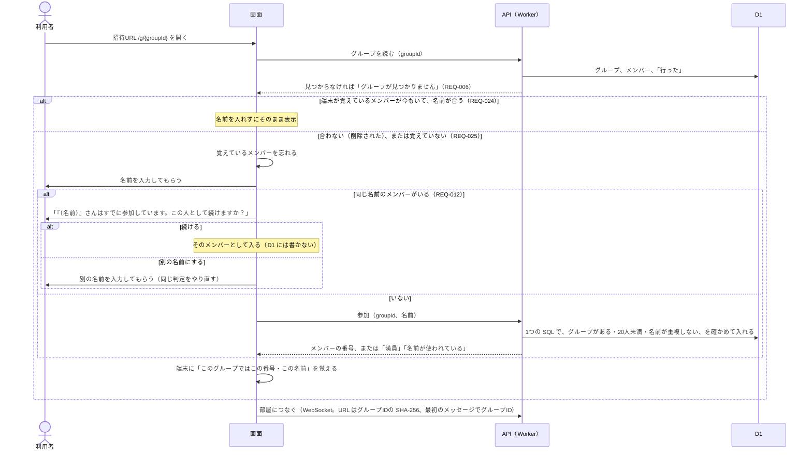

# 名前で入る流れ

状態：下書き（2026-11-06：ログインをやめた（[ADR 0013](../adr/0013-drop-login.md)）ので、ログイン・紐づけ・ログインした状態で入る・ログアウト・退会・同じメールアドレスの節をなくし、名前で入る流れと端末が覚えるものだけにした。ファイル名は、ほかの文書からのリンクを保つためにそのまま。それまでの版は git の履歴に残る。2026-10-15：`/review-docs`（23件）を反映。2026-10-12：Q-017 を決めて、「端末が覚えるもの」の節を足した）

関係する要件：[requirements.md](../requirements.md) の REQ-012（同じ名前の確認）、REQ-022〜REQ-026（名前で本人を決める）、REQ-056（メンバーを変更する）、NFR-002（アプリ内ブラウザ）。

## 前提

- ログインはない。誰もが招待URLと名前だけで入る。API は証明書を受け取らない
- 端末には、グループごとに「覚えているメンバーの番号と名前」を持つ（下の「端末が覚えるもの」）

## 端末が覚えるもの（Q-017）

2026-10-12 にユーザーと決めた（調べた結果は `researcher` による。出典：https://webkit.org/tracking-prevention/ 、https://developer.mozilla.org/en-US/docs/Web/API/Storage_API/Storage_quotas_and_eviction_criteria）。

| 項目 | 決めたこと |
|---|---|
| 覚える中身 | グループIDごとに「メンバーの番号」と「名前」だけ。グループ名や「行った」は覚えない（毎回 API から読む） |
| 保存先 | ブラウザの `localStorage`（サーバーには送らない）。サーバーが付けるクッキーに端末の番号を持つ案は、作るものと権限の検討が増えるので採らない。Safari で入れ直す人が多いと分かったら見直す |
| 複数のグループ | グループIDをキーにして、グループごとに1人ずつ覚える |
| 覚えるとき | グループに入ったときはいつも、そのメンバーを覚え直す：参加した、同じ名前の確認で入った、グループを作った |
| 忘れるとき | 退出、グループの削除、「メンバーを変更する」（REQ-056）、開いたグループが見つからない、自分のメンバーが削除されていた、覚えていたメンバーが合わない（REQ-025）（[screens.md](screens.md) の「操作の後に開く画面」） |
| 共用の端末 | 使い終わったら「メンバーを変更する」で忘れてもらう（requirements の「分かっている限界」） |
| ブラウザごと | 覚えるものはブラウザごとに別（LINE のアプリ内ブラウザと Safari も別）。そのため LINE の中で開いたアプリの画面は、外部ブラウザで開き直す（[screens.md](screens.md) の「画面のルール」、NFR-002） |
| 書けないとき | シークレットモードや容量不足で `localStorage` に書けなくても、画面は止めない（読み書きを `try…catch` で包む）。覚えられないだけで、名前を入れれば使える |

2026-11-06 に「ログインの状態の目印」と「ログアウト・退会のとき」の行をなくした。

**Safari では消えることがある**：iPhone・Mac の Safari（iPhone の Chrome も同じかは要確認）は、Safari を使った日が7日分たまる間にそのサイトを一度も操作しないと、`localStorage` と IndexedDB を丸ごと消す（追跡防止。ホーム画面に追加したアプリは対象外）。旅行の相談のときだけ開く人では、消えるのが普通と考える（仮定：数週間〜数か月おきに開く）。
- 消えたら、何も覚えていないときと同じに名前の入力から入る（「前回の名前が見つかりませんでした」は出ない。消えたのか初めてなのかを見分けられないため）。同じ名前を入れれば、同じ名前の確認（REQ-012）で元のメンバーに入れる
- Android の Chrome と PC のブラウザでは、容量不足か利用者が消したときしか消えない
- iPhone の Chrome（中身は WebKit）でも同じに消えるかは、公式の記述がない。Phase 2 で実機で確かめる（要確認）

## 名前で参加する

- 画面が「同じ名前のメンバーがいるか」を見て分けるのは案内のため。実際の重複は D1 の `UNIQUE (group_id, name_key)` が守る（NFR-006 (11)）。2人がほぼ同時に同じ名前で入ったら、後の方は「名前が使われている」になるので、画面はグループを読み直して、上の判定（REQ-012）をやり直す
- 同じ名前で入るときの確認（「この人として続けますか？」）は、たまたま同じ名前の別人が入ってしまうのを防ぐ（2026-10-10 にユーザーと決めた。REQ-012）
- スマホを替えたときも、招待URLを開いて同じ名前を入れれば、この確認で元のメンバーに入れる
- 「行った」の付け外しと退出は、API にグループIDとメンバーの番号を送る。API は、そのメンバーがそのグループにいることを、書き込む SQL の `WHERE` で確かめる（[data-model.md](data-model.md) の「メンバーの番号で操作する API の共通の決まり」）

## LINE のアプリ内ブラウザ

- 端末が覚えるものがブラウザごとに別なので、招待URLには `?openExternalBrowser=1` を付け、外部ブラウザで開かせる（NFR-002）
