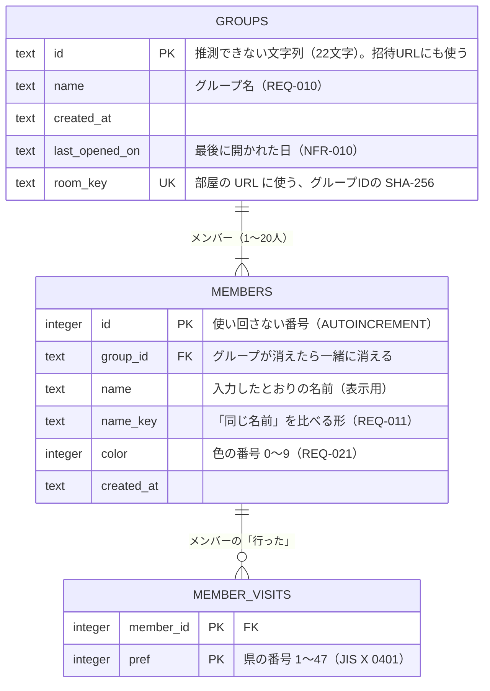

# データモデル

状態：下書き（2026-11-06：ログインをやめた（[ADR 0013](../adr/0013-drop-login.md)）。`accounts`・`account_visits`・`members.uid`・`is_owner`・`groups.manage_by` と、それに関わるトリガー・索引、紐づけ・退会・作成者・管理できる人の節をなくした。それまでの版は git の履歴に残る。2026-10-22：メンバーの10色の番号と色の対応を決めた（「色」）。2026-10-15：`/review-docs` を受けて、メンバーの番号で操作する API の条件を表にし、確認済みかを見る API にグループ一覧とマイページを足し、参加で満員のときも同じ名前を先に見ること、比べる形で絵文字の形の切り替えを取り除くこと、確認を出さないときは合算を送ること、ローカルで済んだ作成者のテストを書いた。2026-10-13：紐づけ・名前の変更・退出・管理の操作・退会の API を作り、この形でテストがローカルで通った（[api](api.md)）。退出・削除で、もういないメンバーは成功（削除は管理できる人のときだけ）、グループがなければ 404 とした。同じ日の `access-reviewer` を受けて、同じ名前への変更は書かない（`name IS NOT ?`）ことと、退出の batch の2つ目の文、紐づけで断ったときに残る `accounts` の行を足した。2026-10-13：API を作った `access-reviewer` の指摘で、メンバーの番号で `(uid IS NULL OR uid = 自分)` を使う対象を退出だけにし（「行った」は `uid IS NULL` だけ）、参加で0行のときにアカウントの行だけ残ることと、読み取りの見積もり（最大約1,000行）を直した。2026-10-12：テーブル定義を [migrations/0001_init.sql](../../migrations/0001_init.sql) に書き、制約のテストがローカルで通った。同じ日の `access-reviewer` の指摘で、API に間違いがあったときの最後の守りを足した：メンバーのグループ・印・参加日時を変えさせない、紐づいた `uid` を変えさせない、20人をトリガーでも守る、整数・文字の型と、ID・`room_key`・日付の形の `CHECK`。2026-10-12：`/review-docs`（24件）を受けて、最後に開かれた日の書き込みを読み取りと分けて失敗を無視する形にし、空にしない形にした。部屋の確かめに使う `room_key` を足し、ER図に2列を足した。問い合わせの保存期間を足した。2026-10-12：Q-025 を決めて、`groups.last_opened_on` と、グループを開くときの更新を足した。2026-10-11：Q-020 の `/review-docs`（21件）を受けて、「行った」の付け外しなどが0行のときに読み直して 404・403 を返す決まりと、503 の理由を足した。2026-10-11：権限マトリクスの `/review-docs`（14件）を受けて、「作成者のみ」は紐づいた作成者だけが通る形にし、別の名前で紐づけたときの戻し方、10グループのトリガーの条件、ID トークンを確かめられないときのエラー、NFR-006 (12)(13) を足した。2026-10-10：[ADR 0003](../adr/0003-backend-selection.md) が案 C（Cloudflare Workers＋Hono＋D1、認証だけ Firebase Authentication）に決まったので、Firestore の版から D1 の版に書き直した。元の版は git の履歴にある。形は [spike/migrations/0001_init.sql](../../spike/migrations/0001_init.sql) の試作をもとにし、試作から変えたところは「試作からの変更」に書いた。2026-10-10 にユーザーと決めた：作成者はメンバーの印 `is_owner` で持つ（[ADR 0005](../adr/0005-owner-flag-on-member.md)）、メールアドレスは D1 に持たない、色は10色、紐づいたメンバーは本人だけが操作できる（Q-018）。同じ日の `/review-docs`（26件）を反映）

## 考え方

- データの正本は D1（SQLite）の1か所。リアルタイムの部屋（Durable Objects）は「変わったこと」を配るだけで、データを持たない（[ADR 0003](../adr/0003-backend-selection.md) の「リアルタイムの共有」）
- 画面を改造されても破られたくない決まり（NFR-006）は、できるだけデータベースの制約（`NOT NULL`・`CHECK`・`UNIQUE`・外部キー・トリガー）に持たせる。制約で書けないものは API の1つの SQL か batch の中で判断する（D1 には途中で他の人を待たせるトランザクションがないため）
- **batch が取り消されるのはエラーのときだけ**。条件付きの `UPDATE` や `INSERT … SELECT … WHERE` が0行でも成功として扱われ、batch の残りは実行される。そのため、batch の中で「前の文が成功したときだけ」動かしたい文には、前の文の結果を `WHERE EXISTS (…)` で確かめる条件を付けるか、断りたい場面をトリガーでエラーにする
- 同じ事実を2か所に持たない（片方だけ古くなると抜け道になる：[learnings](../learnings/2026-10-02-owner-and-slot-lifecycle.md)）
- 個人情報は要るものだけ持つ（NFR-007）

## ER図

県の名前と地図の形は、データベースに持たず画面に埋め込む。2026-11-06 に、ログインをやめたので `accounts`・`account_visits`・`members.uid`・`members.is_owner`・`groups.manage_by` をなくした（[ADR 0013](../adr/0013-drop-login.md)。まだ本番で流していないので `0001_init.sql` を書き換える）。

## テーブル

列はすべて `NOT NULL`。整数の列（県、色）と文字の列（名前）には、`CHECK` に `typeof(…) = 'integer'`・`'text'` も入れる（SQLite は型を厳しく見ないので、`13.5` の県を入れると1人で何行でも書けてしまう。2026-10-12：`access-reviewer` #3）。SQLite では `CHECK` に `NULL` を入れても違反にならず、普通の表の複合の主キーも `NULL` を許すため、`NOT NULL` を書かないと空の行が入りうる。

### groups（グループ）

| 列 | 型 | 決まり | 要件 |
|---|---|---|---|
| `id` | TEXT | 主キー。英数字22文字（約128ビット）。`crypto.getRandomValues` で取り、62種類に割り切れない値は捨てて引き直す（偏りを出さない。試作は偏りを許していた）。`CHECK (length(id) BETWEEN 20 AND 64)` | NFR-005 |
| `name` | TEXT | `CHECK (length(name) BETWEEN 1 AND 400)`。見た目の1〜20文字は API で数える。ここは大量のデータを書かれないための、余裕のある上限 | REQ-010、NFR-006 (8) |
| `created_at` | TEXT | 作った日時（UTC の ISO 8601） | NFR-010 |
| `last_opened_on` | TEXT | 最後に開かれた日（日本時間の日付 `YYYY-MM-DD`。時刻は持たない）。作るときにその日の日付を入れる（空にしない。`CHECK` で `YYYY-MM-DD` の形だけ通す）。直近30日に開かれたグループを数えるため（2026-10-12：Q-025） | NFR-010 |
| `room_key` | TEXT | `UNIQUE`、`CHECK (length(room_key) = 64)`。グループIDの SHA-256（16進）。部屋の URL に入れ、Worker が部屋につなぐ前に、この列で引いてグループがあることを確かめる（グループIDを URL に出さないため。2026-10-12：Q-031 の `/review-docs` #3） | NFR-005・NFR-003 |

名前の長さの上限について：SQLite の `length()` は見た目の文字数ではなく、文字を作る部品（コードポイント）の数を数える。家族の絵文字のように、見た目は1文字でも7つ以上の部品からできている文字があるので、見た目の文字数の上限（名前10、グループ名20）の約20倍を保存の上限にする（2026-10-10 にユーザーと決めた）。

### members（メンバー）

| 列 | 型 | 決まり | 要件 |
|---|---|---|---|
| `id` | INTEGER | 主キー。`AUTOINCREMENT` で、消したメンバーの番号を使い回さない（端末が覚えている番号が、後から入った別の人を指さないため） | REQ-025 |
| `group_id` | TEXT | `REFERENCES groups (id) ON DELETE CASCADE` | REQ-047 |
| `name` | TEXT | 入力したとおり（前後の空白は API で取る）。`CHECK (length(name) BETWEEN 1 AND 200)`。見た目の1〜10文字は API で数える | REQ-009、NFR-006 (8) |
| `name_key` | TEXT | 比べる形。API で NFKC にそろえ、見た目を変えない部品（絵文字の形の切り替え U+FE0E・U+FE0F、ZWJ、旗のタグ文字）を取り除き、続いた空白を1つにまとめてから小文字にする（NFKC で長くなる文字がある：「㍻」→「平成」。部品を取り除くことと空白をまとめることは 2026-10-15 に足した：[api](api.md) の「共通の決まり」）。`CHECK (length(name_key) BETWEEN 1 AND 200)` | REQ-011 |
| `color` | INTEGER | 色の番号。`CHECK (color BETWEEN 0 AND 9)`（10色）。下の「色」 | REQ-021 |
| `created_at` | TEXT | 参加した日時 | — |

制約と索引：
- `UNIQUE (group_id, name_key)`：1つのグループで同じ名前は1人だけ（NFR-006 (11)）
- トリガー（D1 で使えると明言した公式の記述はない：要確認。ローカル（`wrangler` の D1）では、トリガーと `RAISE(ABORT)` が動き、batch ごと取り消されることを確かめた〔済：ローカル。2026-10-12、[api/test/schema.test.ts](../../api/test/schema.test.ts)〕。最初の本番のデプロイで本物の D1 で試す〔未〕。使えなければ、同じことを API のテストで守る）：
  - `id`・`group_id`・`created_at` の `UPDATE` は断る（`RAISE(ABORT)`）。メンバーを別のグループに移して、20人の上限をすり抜けさせない（`group_id` は 2026-10-12：`access-reviewer` #1）。名前を変える正しい操作もない（REQ-015）が、`name` は断らない（運営者が削除の依頼で手で直すことがあるため。API には名前を変える文がない）
  - 同じグループにメンバーがすでに20人いれば、`INSERT` を断る（NFR-006 (8)。参加の SQL の `WHERE` でも確かめ、0行なら「満員」と返す。こちらは API に間違いがあったときの最後の守り。2026-10-12：`access-reviewer` #5）

### member_visits（メンバーの「行った」）

| 列 | 型 | 決まり |
|---|---|---|
| `member_id` | INTEGER | `REFERENCES members (id) ON DELETE CASCADE` |
| `pref` | INTEGER | `CHECK (pref BETWEEN 1 AND 47)` |

主キーは `(member_id, pref)`。1県1行。押し直しても結果が変わらず、別の県を同時に塗っても消し合わない（NFR-009）。

## 設計のポイント

### 色

- 10色（2026-10-10 にユーザーと決めた。モックは6色だった）。番号 0〜9 と実際の色の対応は画面が持つ（D1 には番号だけ）
- 番号と色の対応（2026-10-22 にユーザーと決めた。0〜5 はモックの6色、6〜9 は推奨で足した4色。黄色は「全員まだの県」の強調の色と見分けにくいので入れない。見た目は後で直してよい。直しても D1 の番号は変えなくてよい）：

| 番号 | 色 | 番号 | 色 |
|---|---|---|---|
| 0 | 青 `#2F7FD1` | 5 | オリーブ `#7B8A1E` |
| 1 | オレンジ `#E0692F` | 6 | 赤 `#C93C3C` |
| 2 | 緑 `#2A9D6E` | 7 | 青緑 `#1A9BB0` |
| 3 | 紫 `#9B5BD0` | 8 | 茶 `#8C5A3C` |
| 4 | ピンク `#D2497A` | 9 | 紺 `#4A5D8A` |

- 参加したときに、同じグループで使われていない番号の小さい順に決める。10色すべて使われていれば、使っている人が一番少ない番号（同じなら小さい番号）にする（REQ-021）
- 参加の SQL の中で決める。2人がほぼ同時に入ると同じ色になることがあるが、重複は許しているので受け入れる
- 色を変える API は作らない

### メールアドレス

アプリが預かるメールアドレスは、問い合わせのフォーム（NFR-018）の返信先だけ（ログインをやめたので、ログインのメールアドレスはない：2026-11-06）。返信先は任意で、入れた人だけ持つ（2026-11-06 にユーザーと決めた：ADR 0013）。表の形は問い合わせの項目で決める。返信先と本文は、対応が済んでから3か月で消す（2026-10-12：`/review-docs` #5。推奨の仮の値）。

### メンバーの番号で操作する API の共通の決まり

- 判断は書き込む SQL の `WHERE` に入れ、どれも `id = ?番号 AND group_id = ?グループ` で、そのグループのメンバーであることを確かめる（ほかのグループのメンバーの番号を送っても、何もしない）
- 本人を見分けられないので、メンバーの番号を知っている人（グループを開けば分かる）なら誰でも通る（信頼ベース。requirements の「分かっている限界」）
- 名前を変える API はない（REQ-015）。グループ名の変更は、同じ名前なら書かない（`AND name IS NOT ?新しい名前`。同じ値を繰り返し送られても書き込みの枠を使わない。2026-10-13：`access-reviewer` #3）

### 「行った」の付け外し

1つの SQL で、そのグループのメンバーであることを確かめて書く。

- 付ける：`INSERT INTO member_visits (member_id, pref) SELECT ?, ? WHERE EXISTS (SELECT 1 FROM members WHERE id = ? AND group_id = ?) ON CONFLICT (member_id, pref) DO NOTHING`
- 外す：`DELETE FROM member_visits WHERE member_id = ? AND pref = ? AND EXISTS (同じ条件)`
- `INSERT OR IGNORE` は使わない（[rules/sql.md](../../.claude/rules/sql.md)）
- **0行だったときは、読み直して理由を返す**（2026-10-11：Q-020 の `/review-docs` #1）。条件付きの書き込みは、グループやメンバーが消えていても0行で「成功」になり、画面は消されたことに気づけない。グループがなければ 404（グループがない）、メンバーがいなければ 404（メンバーがいない）を返す。付けるときにもともと付いていた・外すときにもともと行がなかった（グループとメンバーはある）ときは成功とする。メンバーの番号で書くほかの API（退出など）も同じに読み直して分ける（退出でメンバーがもういないときは成功とする）

### グループを作る

1つの batch：

1. `groups` を入れる（`last_opened_on` は今日の日付、`room_key` はグループIDの SHA-256 を API で計算して入れる）
2. `members` に最初のメンバーを色 0 で入れる

### 参加する

1つの SQL で、グループがあること・20人未満であることを確かめて入れる（`INSERT … SELECT … WHERE EXISTS (…) AND (SELECT count(*) …) < 20`。REQ-005、NFR-006 (8)）。色の番号もこの SQL の中で決める。

- 名前の重複は `UNIQUE` で失敗させ、API が理由を読み分ける
- 0行なら、API が読み直して理由を分ける。グループがなければ「グループがない」。満員のときは人数の確かめで止まり、同じ名前の確かめ（`UNIQUE`）まで進まないので、先に「同じ名前の人がいる」（`name_taken`）を見て、そうでなければ「満員」とする（すでにいる人が戻ってくるのを満員で断らないため。人数は増えないので REQ-005 に反しない。2026-10-15：`/review-docs` #4）

### グループを開く

1回の batch で、グループ、メンバー、メンバーの「行った」を読む。「行った」は `members` と結合してそのグループの分だけを読む。

- グループIDを知っている人なら読める（NFR-005 と同じ強さ。API ではメンバーかどうかを見分けられない）
- 読み取りの batch とは**別に**、応答を返した後（`ctx.waitUntil`）で `UPDATE groups SET last_opened_on = ?今日 WHERE id = ? AND last_opened_on < ?今日` を流す。失敗しても無視する（記録のための書き込みで、D1 の書き込みの枠だけが尽きた日も、地図を開けるようにするため。同じ batch に入れると、1文の失敗で読み取りも取り消される。2026-10-12：`/review-docs` #1）。同じ日の2回目からは0行で、書き込みはグループごとに1日1回まで（NFR-010。0行のときに書き込みに数えられないかは `meta.rows_written` で確かめる：要確認）。誰が開いたかは残さない。テストに「この書き込みが失敗しても開ける」を入れる

### 退出・削除

- **退出**（REQ-049）・**メンバーの削除**（REQ-048）：メンバーを消すのと、「0人ならグループを消す」を同じ batch にする（REQ-050。Q-010）。「行った」は外部キーで一緒に消える。どちらも上の「共通の決まり」の `WHERE` で確かめる（退出と削除の違いは、画面の確認の文と、その後に開く画面だけ）
  - 「0人ならグループを消す」文（`DELETE FROM groups WHERE id = ? AND NOT EXISTS (メンバー)`）は、前の文の結果を見ない。0人のグループはどの操作でも残らないので、消えるのはこの操作で0人になったグループだけ。運営者が手で直したときなどに0人のグループが残っていれば、断られた退出でも消えるが、消して困るものはない（2026-10-13：`access-reviewer` #7。テストで動きを固定した）
  - メンバーがもういないとき（2回押した、ほかの人が先に消した）は成功とする
- **グループの削除**（REQ-047）：`groups` の行を消せば、メンバーと `member_visits` が外部キーで消える

## 保存先で守るもの（NFR-006）との対応

NFR-006 の「保存先」は、案 C では「API とデータベースの制約」と読む。画面の確認は改造で破れるので数えない。(1)〜(6)・(9)・(10)・(12)・(13) は、2026-11-06 にログインと作成者をやめてなくした。

| NFR-006 | 守る場所 |
|---|---|
| (7) グループIDを知らなければ読めない、一覧できない | 推測できないID と、一覧する API を作らないこと |
| (8) 20人まで、名前の長さ | 20人は参加の SQL の `WHERE` とトリガー、長さは `CHECK` |
| (11) 名前の重複 | `UNIQUE (group_id, name_key)` |

立場ごと・操作ごとの一覧は [permissions.md](permissions.md)（権限マトリクス）。

制約を足したら、違反がエラーになるテストを1つ書く（[rules/sql.md](../../.claude/rules/sql.md)）。API で守るものは、Vitest で、改造した画面を想定したリクエストを送って確かめる。

## 持たないもの

- アカウント、ログインのメールアドレス、作成者（2026-11-06：ADR 0013）
- 最後に使った日時（時刻）、誰が開いたか：数えるのに要るのはグループごとの日付だけ（`groups.last_opened_on`。Q-025）
- 問い合わせ（NFR-018）：問い合わせのフォームの項目で表を足す

## 試作からの変更

[spike/migrations/0001_init.sql](../../spike/migrations/0001_init.sql) から変えたところ。

- `groups.owner_member_id` をなくした（試作は作成者を持っていた。2026-10-10 に `members.is_owner` にし、2026-11-06 に作成者そのものをなくした）
- `visits` を `member_visits` にした
- `members.color`、`created_at`、トリガーを足した
- `created_at` は、入れるときに省けば今の日時（UTC）が入る（`DEFAULT`）
- 名前の長さの上限を 40 から 200（グループ名は400）にした
- `visits` の列に `NOT NULL` を足した

## 読み書きの回数の見積もり

D1 の Free の枠（2026-10-10 に `researcher` で公式を確認）：読み取り1日500万行、書き込み1日10万行（日本時間9時に戻る。超えたらエラーで止まり、請求はない）、1データベース500MB、1回の Worker の呼び出しで送れる SQL は50本まで（batch の中の文も数える）。書き込みは、変えた行の数に加えて、索引の分も数えられる。外部キーの `CASCADE` で消える行とトリガーが数えられるかは公式に記述がない（要確認：本物の D1 で `meta.rows_written` を見て確かめる。見積もりでは数えられるとみなす）。

- 読み取り：NFR-015 の規模で約10万行/日（約2%。ADR 0003 の見積もり）。グループを開くたびに読む行は、メンバー20人が全員30県を付けていても約620行、全員47県なら約1,000行（索引を引く分を含めた本物の数は `meta.rows_read` で確かめる〔未〕。使い切られる見積もりは [architecture](architecture.md) の「無料枠を使い切られないために」）
- 書き込み：付け外し1回で、表の1行と主キーの索引で約2行。1日2,500回（ADR 0003 の仮定）で約5,000行。参加・退出・グループの削除（`CASCADE` で最大20人と各47県）を足しても、1日1万行（約10%）に届かない見込み
- 1回の API で送る SQL は、どの操作も10本に届かない

出典：https://developers.cloudflare.com/d1/platform/pricing/ 、https://developers.cloudflare.com/d1/platform/limits/ 、https://developers.cloudflare.com/d1/best-practices/use-indexes/
