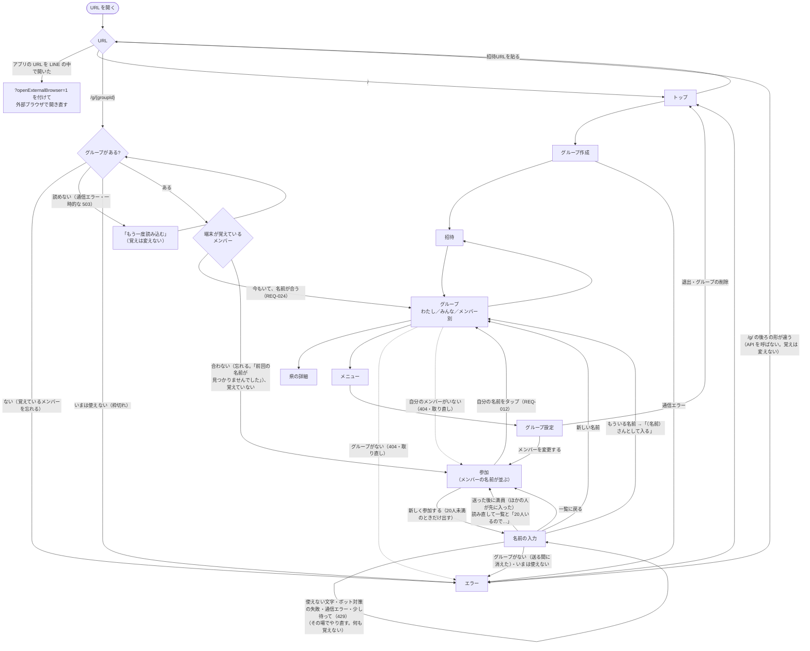

# 画面

状態：下書き（2026-11-10：L-1 の2回目の `/review-docs` を受けて、遷移図に失敗の矢印を足し、名前を入れている間に満員になったら参加の画面に戻すことにし（ユーザーが推奨どおりに決めた）、「もういます」で出す名前・覚える名前を一覧の表示名にし、正本はこの表で `tools/template.html` は古い形と書いた。2026-11-09：参加の画面を、メンバーの名前を選ぶか「新しく参加する」で名前を入れる形にした（REQ-012。モックを見てユーザーと決めた）。同じ名前の確認のダイアログをなくし、遷移図・参加の画面・API の応答の表を直した。L-1 の `/review-docs` を受けて、遷移図に参加の通信エラーを足した。2026-11-06：ログインをやめた（[ADR 0013](../adr/0013-drop-login.md)）ので、アカウントの入口・ログイン・グループ一覧・マイページ・外部ブラウザの案内の画面、`/account`・`/login`・`/groups`・`/me` の URL、遷移図のログイン済みと紐づけの分岐、確認待ちの表示、管理できる人の表示、退会・合算・本人確認の確認、ログインと紐づけの知らせと応答の行をなくした。立場が1つになったので、立場ごとの出口の表もなくした。それまでの版は git の履歴に残る。2026-10-31：トップの文と画像を「トップと URL」に足した。2026-10-28：確認ダイアログの形と、退出・グループの削除をやり直して 404 になったときの行き先を足した（仮の値）。2026-10-28：グループ設定の形と文、LINE の中かどうかの見分け方を足した。2026-10-26：帯の「読み直す」と、リアルタイムで読み直したときの失敗の動きを仮で足した（ADR 0012）。2026-10-23：グループを読めなかったときの文とボタン、ボット対策が読み込めないときの文、閉じられないシートの一番下のリンクを足した。2026-10-22：使い道の文、グループIDの形が違う URL の文を足した。2026-10-16：地図データの出典を足した（ADR 0007）。それより前の経緯は git の履歴に残る）

画面の配置は [ワイヤーフレーム](wireframes.drawio.svg)（draw.io。2026-10-12 に作った案。ログインの画面の枠は 2026-11-06 の時点で残っていて、直すまではこの文書が正本）で示す。見た目と文言は βテスト（Phase 4）で整える。ここでは、どの画面があり、どこからどこへ移り、何を知らせるかを書く。言葉は [用語集](../glossary.md) と [権限マトリクス](permissions.md) にそろえる。

## 画面一覧

| 画面 | 種類 | モック | 内容 |
|---|---|---|---|
| トップ | ページ | なし | 検索に出す素の HTML。アプリの説明、「グループを作る」、招待URLを貼る欄。中身は下の「トップと URL」 |
| グループ作成 | シート | あり | グループ名と自分の名前。トップから開く（REQ-001） |
| 参加 | シート | あり | 招待URLから開いたとき。グループ名と参加中のメンバーの名前を出し（REQ-002）、自分の名前を選ぶか、「新しく参加する」で名前を入れてもらう（REQ-012）。中身は下の「参加の画面」 |
| 招待 | シート | あり | 招待URLの表示とコピー |
| グループ（わたし／みんな／メンバー別） | ページ | あり | 地図と一覧。アプリの中心 |
| 県の詳細 | シート | あり | その県に誰が行ったか |
| メニュー | シート | なし | グループの画面のヘッダーから開く。中身は下の「メニューの中身」 |
| グループ設定 | シート | なし | 下の「グループ設定の中身」 |
| 確認ダイアログ | ダイアログ | なし | 退出、メンバーの削除、グループの削除。中身は下の「確認ダイアログ」 |
| エラー | ページ | なし | グループが見つからない（削除された）、通信エラー、いまは使えない（NFR-012）。満員は参加の画面の一言で伝える（2026-11-10）。「トップへ」のボタンを置く |
| 使い方 | ページ | なし | 検索に出す素の HTML（NFR-019）。下の「トップと URL」 |
| プライバシーポリシー | ページ | なし | 検索に出す素の HTML（NFR-008・NFR-019） |
| 問い合わせ | ページ | なし | 削除の依頼などのフォーム（NFR-018）。送り先はアプリの API |

アプリの画面はすべて、ヘッダーからトップへ戻れる（遷移図では省く）。

## 画面遷移図

- 名前の入力は、参加の画面の中で開く（シートを重ねない）。「もういます」の文とボタンも、名前の入力の中で出す（ダイアログにしない）
- 端末に覚えるのは、グループに入れたとき（上の矢印で Group に着いたとき）だけ。失敗の矢印では何も覚えない（[auth-flow](auth-flow.md)）
- 行き止まり：どの画面もヘッダーか「トップへ」のボタンでトップに戻れる。ログインがないので、ログアウトと退会の出口はない（2026-11-06 に「立場ごとの出口」の表をなくした）

## グループの画面の中身

モックの画面を引き継ぐ（2026-10-12 に要件IDの対応を付けるときに書き出した。配置は [ワイヤーフレーム](wireframes.drawio.svg)）。

| 場所 | 中身 | 要件 |
|---|---|---|
| ヘッダー | グループ名、招待（招待のシートを開く）、メニュー（自分の名前のボタン）。グループを切り替えるボタンは置かない | REQ-003・REQ-026 |
| タブ | わたし／みんな／メンバー別 | REQ-016〜REQ-020 |
| まとめ | わたし：自分の行った県の数（「N / 47」）。みんな：誰かが行った県の数と、メンバーごとの行った県の数（多い順）。メンバー別：メンバーを選ぶボタンと、その人の行った県の数 | REQ-016・REQ-053・REQ-020 |
| 地図 | わたし：自分の「行った」を塗り、タップで付け外し。みんな：行った人が多い県ほど濃く塗り、全員まだの県を強調（切り替えられる）。メンバー別：選んだ人の「行った」だけ。県をタップすると県の詳細 | REQ-016〜REQ-020 |
| 色の凡例 | みんな：人数と濃さの対応。メンバー別：その人の色 | REQ-017・REQ-021 |
| 全員まだの県 | みんな：県の数と県名の一覧（タップで県の詳細）、「地図で強調」の切り替え。ないときは「全県だれかが行っています」 | REQ-054・REQ-018 |
| 地方ごとの一覧 | 地図の下に、県を地方ごとに並べる。地図と同じ操作ができる | REQ-055 |
| 一番下 | 「プライバシーポリシー・お問い合わせ」の小さなリンク。地図データの出典（下の「画面のルール」） | NFR-008 |

**県の詳細**（シート）：「N人中M人」と、行った人の名前（色付き）。全員まだなら旅行先の候補として勧める文。「自分も行ったことがある／自分の『行った』を外す」のボタン（REQ-019）。

**招待**（シート）：招待URLとコピーのボタン。スマホではシェアのボタン（Web Share API が使えるとき）も出す（REQ-002・REQ-003）。

## 参加の画面

| 項目 | 中身 |
|---|---|
| グループ名と参加中のメンバーの数（REQ-002） | 出す。アイコンは4人まで重ねて出す |
| メンバーの名前の一覧 | 見出し「あなたはどれ？」の下に、参加中のメンバーを参加した順に2列で並べる（色の丸と名前）。タップすると、確かめずにそのメンバーとして入り、端末に覚える。API は呼ばない（REQ-012・REQ-024）。一覧を開いた後にその人が削除されていても、ここでは気づかない。入った後に部屋につなぐときにグループを読み直すので、そこで「（名前）さんはグループから削除されました」になる（下の「知らせ」） |
| 入った後の知らせ | 「（名前）さんとして開きました。違うときはメニューの『メンバーを変更する』から選び直せます」 |
| 新しく参加する | 一覧の下にボタン「＋ 新しく参加する」。押すと、その場で名前の入力（「あなたの名前」、使い道の一言、ボット対策、「参加する」、「一覧に戻る」）を開く。名前はグループごとに入れる（REQ-007） |
| 新しく参加で、もういる名前を入れた | 一覧のその人に色を付け、「（名前）さんはもういます。あなたなら、そのまま入れます」とボタン「（名前）さんとして入る」、その下に「別の人なら、名前を変えてください」（REQ-012。API の `409 name_taken`）。（名前）と端末に覚える名前は、一覧で `memberId` が同じ人の表示名を使い、入れた文字は使わない（全角・半角などが違っても同じ名前とみなす：REQ-011。入れた文字を覚えると、次に開いたときに一覧と合わなくなる。2026-11-10 にユーザーが推奨どおりに決めた） |
| 満員（20人） | 「新しく参加する」の代わりに「20人いるので、新しくは参加できません」。名前の一覧はそのまま押せる（REQ-005） |
| 覚えていたメンバーが合わなかったとき | 一番上に「前回の名前が見つかりませんでした」（REQ-025） |
| ボット対策（Turnstile） | 名前の入力の「参加する」の上にだけ置く（名前を選んで入るときは API を呼ばないので要らない）。送るたびに新しいトークンを取る（1回しか使えないため） |

文（見出し、ボタン、知らせ、満員の一言）は、2026-11-09 にモック（チャットで見せたページ。リポジトリには置かない）を見てユーザーと決めた。**正本はこの表**で、リポジトリのモック `tools/template.html` の参加の画面は前の形（名前を入れて確かめる）のまま（7-4 で消すので直さない。2026-11-10 にユーザーが推奨どおりに決めた）。βテスト（Phase 4）で整える。

グループ作成の画面にも、「作る」の上に同じボット対策を置く（Q-031）。ボット対策の確認が済む（トークンが取れる）まで、「作る」「参加する」は押せない（2026-10-23 にメインが決めた仮の動き。Cloudflare のふだんの確認はほとんど自動で済むため）。読み込めなかったときは「確認に失敗しました。もう一度お試しください」を出し、試し直すのはページの読み直し（その場で試し直すボタンは置かない。2026-10-23）

満員かどうかは、グループを開いたときのメンバーの数で画面が分ける（案内のため。20人の正本は API と制約：NFR-006 (8)）。名前を入れている間にほかの人が入って満員になったら、送った後に `409 group_full` が返るので、グループを読み直して参加の画面（一覧と「20人いるので、新しくは参加できません」）に戻す（実はメンバーだった人も一覧から選べるように。2026-11-10 にユーザーが推奨どおりに決めた。それまではエラーの画面に移すと書いていた）。満員のグループでは「新しく参加する」を出さないので、満員で同じ名前を入れる場面は画面からは起きない。改造した画面で起きても、API が先に同じ名前を見て `409 name_taken` を返す（[api](api.md)。人数は増えないので REQ-005 に反しない）。

## トップと URL

2026-10-12 にユーザーと決めた（Q-016）。トップ・使い方・プライバシーポリシーは検索に出す素の HTML、ほかはアプリの画面（React、`noindex`）にする（[architecture](architecture.md) の「検索に出すページと出さないページ」）。

| URL | 画面 | 種類 |
|---|---|---|
| `/` | トップ | 素の HTML（検索に出す） |
| `/guide` | 使い方 | 素の HTML（検索に出す） |
| `/privacy` | プライバシーポリシー | 素の HTML（検索に出す） |
| `/g/{groupId}` | グループ（参加） | アプリ |
| `/new` | グループ作成 | アプリ |
| `/contact` | 問い合わせ | アプリ |

2026-11-06 に `/account`・`/login`・`/groups`・`/me` と、確認メール・パスワードの再設定のリンク先をなくした。

**トップの中身**（文は 2026-10-31 にユーザーと決めた。推奨どおり。見た目と文言は βテストで整える）：
- タブの名前「旅会議マップ｜友達と行った都道府県を塗って、次の旅行先を決めよう」、見出し「旅会議マップ」、一言の説明「友達と行った都道府県を塗って、次の旅行先を決めよう」（招待URLのカード（OGP）と同じ文）
- 地図の画像：招待URLのカードの画像（`ogp.png`）をそのまま使う
- 特徴3つ：「登録なしで使える」名前を入れるだけ。アカウントは要りません。／「みんなで地図を塗る」行った県を押すと、グループの地図にすぐ出ます。／「全員まだ行っていない県が分かる」次の旅行先の候補が一目で分かります。
- 使い方の3ステップ：「作る」グループ名と自分の名前を入れる → 「招待する」招待URLを LINE などで送る → 「塗る」行った県を押す
- 大きなボタン「グループを作る」（`/new`）
- **招待URLを貼る欄**：小さく置く。小見出し「招待URLをもらった人」、欄の中の薄い字「招待URLを貼る」、ボタン「開く」（2026-10-31）。貼られた文字からグループID（英数字22文字：[data-model](data-model.md) の `groups.id`）を取り出して `/g/{groupId}?openExternalBrowser=1` を開く。フォームで送らず、画面の中だけで取り出して移る（貼った文字がトップの URL やアクセス解析に載らないため）。グループIDの形でなければ「招待URLの形ではありません」と出す（リンクを PC でもらってスマホで開きたいときなどのため。2026-10-12 にユーザーと決めた）
- 下に、使い方・プライバシーポリシー・お問い合わせへのリンク
- アカウントの入口は置かない（2026-11-06：ADR 0013。それまでは Phase 3 で置く予定だった）

**使い方の中身**：作る → 招待する → 塗る の手順、よくある質問（名前を打ち間違えた、スマホを替えた・名前をまた選ぶことになった（Safari で端末が覚えていたものが消えた）、本名を入れなくてよいか、グループを消したい、データを消してほしい）。文は使い方の項目で決める。

## メニューの中身

グループの画面のヘッダーから開く（モックの「自分の名前」のボタンの位置。配置はワイヤーフレームで決める）。

| 項目 | |
|---|---|
| グループ設定 | ○ |
| トップ、プライバシーポリシー、問い合わせ | ○ |

2026-11-06 に、ログイン、確認待ちの表示、グループ一覧、マイページの項目をなくした。

## グループ設定の中身

| 項目 | |
|---|---|
| グループ名の変更、グループの削除、メンバーの削除 | ○（メンバーなら誰でも：REQ-046〜REQ-048） |
| 退出 | ○ |
| メンバーを変更する（REQ-056） | ○ |

2026-11-06 に、「管理できる人」の表示と、自分の名前の変更（REQ-014）をなくした。

形と文（2026-10-28 にユーザーと決めた。推奨どおり）：
- **グループ名の変更**：「グループ名：（名前）［変更］」。［変更］を押すと、その場でいまの名前が入った入力欄と［保存］［やめる］に変わる（シートを重ねない）。決まりと断る文はグループ作成と同じ（20文字まで、`400 bad_name`）。成功したら知らせ「グループ名を変更しました」
- **メンバーの一覧**：自分以外を出す。自分しかいないときは「メンバー」の欄ごと出さない（2026-10-28 にメインが決めた仮の形。新しい文を足さないため）
- **メンバーの削除**：成功したら知らせ「（名前）さんを削除しました」。退出とグループの削除はトップに移るので、知らせは出さない
- **メンバーを変更する**（REQ-056）：「退出する」の上に、ボタン「ほかのメンバーに切り替える」と一言「（名前）さんのデータは消えません。名前を選ぶ画面に戻ります」（2026-11-09：参加の画面を変えたので「名前の入力に戻ります」から直した）。消す操作（赤）とは見た目を分ける（要件の名前のままだと「名前を変える」と読み違えやすいため）

## 確認ダイアログ

削除したものは戻せない（NFR-017）ので、消す操作は必ず確認する。消すボタンは赤にする。

| 操作 | 確認の中身 | 要件 |
|---|---|---|
| 退出 | 「（名前）として退出します。このグループでの『行った』は消えます。もう一度入るには招待URLが要ります［招待URLをコピー］」。最後の1人なら「あなたが最後のメンバーです。グループも削除されます」 | REQ-049・REQ-050 |
| メンバーの削除 | 「（名前）さんを削除します。その人のこのグループでの『行った』は消えます」と「招待URLを知っていれば、また参加できます」。自分は一覧に出さない（自分は「退出」を使う） | REQ-048 |
| グループの削除 | 「（グループ名）を削除します。全員（N人）のこのグループでの『行った』が消え、戻せません」。赤い「削除する」を押す（グループ名を打ち込ませるまではしない。2026-10-11 にユーザーと決めた） | REQ-047 |

「メンバーを変更する」（REQ-056）はメンバーを消さないので、確認を出さずに参加に移る。

確認ダイアログの形（2026-10-28 にメインが決めた仮の値）：見出しは表の文の最初の一文、残りを本文にする。確定のボタンは削除の2つが「削除する」（ワイヤーフレームの 9）、退出は「退出する」。退出の［招待URLをコピー］は、招待のシートと同じく URL の文字と並べる（コピーできないときに文字を選べるように）。送っている途中は閉じない。やり直せる失敗（通信エラー・503・429）では開いたまま、読み直す失敗（画面の不具合）では閉じて読み直す。開いている間、キーボードの Tab はダイアログの中だけを回る

## 操作の後に開く画面

| 操作 | 開く画面 | 端末が覚えているメンバー |
|---|---|---|
| 退出、グループの削除 | トップ | そのグループのものを忘れる（忘れないと、次に開いたときに「前回の名前が見つかりませんでした」と出るため） |
| メンバーの削除（ほかの人） | グループ設定のまま | 変えない |
| メンバーを変更する | 参加 | そのグループのものを忘れる（REQ-056） |
| 開いたグループが見つからない | エラー | そのグループのものを忘れる |

## 知らせ

| 場面 | 出し方 | 要件 |
|---|---|---|
| 「行った」の付け外し | 押したら仮の表示（塗り）にして送る。応答が来るまで、その県はもう押せないようにする（続けて押したときや、応答の順番が入れ替わったときに食い違わないため）。成功したら確定。失敗したら最後に保存できた状態に戻す（2026-10-11 にユーザーと決めた：端末に溜めて送り直すことはしない）。送っている間に、ほかの人の変更がリアルタイムで届いたら、それも反映する | NFR-009 |
| やり直せる失敗（通信エラー、一時的な 503） | 「保存できませんでした。もう一度お試しください」。付け外しなら上のとおり元に戻す | NFR-009 |
| やり直しても通らない失敗（もういる名前、満員） | 理由の文を出す（どちらも上の「参加の画面」）。もういる名前で、一覧にその人がいなければ（ほぼ同時に入った）グループを読み直す。満員なら読み直して参加の画面に戻す | NFR-009 |
| いまは使えない（無料枠を超えた） | API は 503 に理由を付けて返す（枠切れか、一時的な失敗か：[api](api.md)）。JSON でない応答（Cloudflare のエラー画面）も枠切れとみなす（[architecture](architecture.md)）。読み込みが止まったら、エラーの画面に「いまは混み合っていて使えません。遅くとも翌朝9時ごろには戻ります」。書き込みが止まったら、同じ文を出し、付け外しは元に戻す。Durable Objects の枠切れは、下の「リアルタイムの知らせがつながらない」と同じ扱い。無料枠を超えたときに API が実際にどんなエラーを返すか（D1・Workers・Durable Objects それぞれ）は Phase 2 で確かめる（要確認） | NFR-012 |
| グループが削除されていた | 書き込みが 404、または部屋から「取り直して」が届いて読み直したら見つからない。「このグループは削除されました」と出し、エラーの画面に移る | REQ-006 |
| 自分のメンバーが削除されていた | 書き込みが 404、または読み直したら自分のメンバーがいない。「（名前）さんはグループから削除されました」と出し、覚えているメンバーを忘れて参加に移る | REQ-048 |
| リアルタイムの知らせが数秒以上つながらない | 5秒つながらなければ、画面の上に細い帯で「自動で更新されていません［読み直す］」と出す（数字は [ADR 0012](../adr/0012-realtime-reconnect-and-no-polling-fallback.md)。2026-10-26）。つながったら消す（会議の場では、画面が自動で変わる前提で見ているため）。つなぎ直す間隔はだんだん長くし（1・2・4・8・16・32秒、その後60秒ごと）、続けて10回失敗したらやめて、帯の「読み直す」か画面に戻ったときにだけつなぐ（部屋への接続も Durable Objects の回数に数えるため。Q-031）。帯の「読み直す」は、グループを読み直し、つなぎ直しの回数を数え直してすぐにつなぐ。読み直しが失敗したら、知らせ「読み込めませんでした。もう一度お試しください」を出す（グループや自分のメンバーが消えていたときは、下の「リアルタイムで読み直したときの失敗」と同じ行き先）（2026-10-26 にメインが決めた仮の動き） | NFR-003 |
| リアルタイムで読み直したときの失敗 | 「取り直して」が届いたとき、知らないメンバーの変更が届いたとき、つなぎ直したとき、画面に戻ったときは、裏でグループを読み直す。グループが削除されていた・自分のメンバーがいないときは、上の2行のとおりに移る。通信エラーや「いまは使えない」のときは、いまの画面のまま何も出さない（会議の途中でエラーの画面に飛ばさないため。2026-10-26 にメインが決めた仮の動き） | NFR-003 |

## API の応答と画面の動き

API は、断るときに `error` の値を返す（[api](api.md)）。画面はこの値で文と行き先を決める。上の「知らせ」の場面と合わせて使う（2026-10-15：`/review-docs` #2・#11）。

| 状態コードと `error` | 返る API | 画面の文 | 行き先・端末が覚えているメンバー |
|---|---|---|---|
| `400 bad_name` | 作成、参加、グループ名の変更 | 入力欄の下に「1〜10文字（グループ名は20文字）で入れてください。見えない文字や一部の記号は使えません」 | その場で入れ直す |
| `400 bad_request`、`413 bad_request`、`404 not_found` | どれでも | 「保存できませんでした。もう一度お試しください」 | 画面の不具合なので、エラーの送信（Sentry）に送り、グループを読み直す（読み直しは1回だけ。グループを開くときに起きたら、自動では読み直さず「もう一度読み込む」のボタンを出す：同じ失敗で読み直し続けないため。2026-10-23）。成功の状態コードなのに応答の形が違う・JSON でないときも、この行と同じに扱う（配信の設定の誤りに気づけるように、枠切れとは分ける） |
| `403 turnstile_failed`（ボット対策の部品が読み込めない・解けないときも同じ：2026-10-23） | 作成、参加 | 「確認に失敗しました。もう一度お試しください」 | ボット対策を出し直して、その場でやり直す |
| `404 group_not_found` | グループの中の API | 「このグループは削除されました」 | 忘れて、エラー（上の「知らせ」） |
| `404 group_not_found` | 退出、グループの削除 | 文は出さない | できたときと同じに、忘れてトップへ（1回目が届いて応答だけ失われ、やり直したときに起きる。抜けたかった・消したかった結果と同じため。2026-10-28 にメインが決めた仮の動き） |
| （API を呼ぶ前）`/g/` の後ろがグループIDの形（英数字22文字：data-model の `groups.id`）でない | — | 「グループが見つかりません。招待URLをもう一度確かめてください」（2026-10-22 にユーザーと決めた仮の文） | API を呼ばずにエラー。端末が覚えているものは変えない |
| `404 member_not_found` | 「行った」 | 「（名前）さんはグループから削除されました」 | 忘れて、参加（上の「知らせ」） |
| `409 name_taken` | 参加 | 「（名前）さんはもういます。あなたなら、そのまま入れます」と［（名前）さんとして入る］（REQ-012） | 名前の入力のまま。一覧にその人がいなければ（ほぼ同時に入った）グループを読み直す。読み直してもいなければ（その間に削除された）、知らせ「読み込めませんでした。もう一度お試しください」を出して一覧に戻る。ボタンで入ったら、返った `memberId` と一覧の表示名を端末に覚える |
| `409 group_full` | 参加 | 「20人いるので、新しくは参加できません」（参加の画面の一言） | グループを読み直して参加の画面に戻す（一覧は押せる）。何も覚えない |
| （グループを開くとき）通信エラー、`503 unavailable`（`reason: "temporary"`） | グループを開く | 「読み込めませんでした。もう一度お試しください」と「もう一度読み込む」のボタン（2026-10-23 にユーザーと決めた仮の文。枠切れ（`reason: "quota"`）は下の 503 のとおり） | その場で読み直す。端末が覚えているものは変えない |
| `429`（WAF のレート制限。JSON でないことがある） | どれでも | 「少し待ってから、もう一度お試しください」 | すぐには送り直さない（[architecture](architecture.md)） |
| `503 unavailable` | どれでも | `reason` で分ける（上の「やり直せる失敗」と「いまは使えない」） | 上の「知らせ」 |

## 画面のルール

- スマホ幅を基本にする（モックと同じ。PC でも崩れずに使える：NFR-001）
- アプリの画面（`/g/*` だけでなく、`/new` などすべて）を LINE のアプリ内ブラウザで開いたら、`?openExternalBrowser=1` を付けて外部ブラウザで開き直す（端末が覚えるものはブラウザごとに別なので、LINE の中で作ったグループを外部ブラウザが覚えていない、ということを防ぐ。2026-10-12 にユーザーと決めた：NFR-002）。検索に出すページ（トップ、使い方、プライバシーポリシー）は LINE の中でもそのまま読める。LINE の中かどうかは、ブラウザの名乗り（User-Agent）に ` Line/` があるかで見分ける。もう `?openExternalBrowser=1` が付いているのに LINE の中で開いた（パソコン版や古い版の LINE は外に出さないことがある）ときは、開き直さず、そのまま使ってもらう（参加・塗るは LINE の中でも動く。案内の帯は出さない）。外部ブラウザで開いた後も、最初に開いた URL の `?openExternalBrowser=1` は消さない（アドレス欄からコピーして LINE で送っても外に出るため）。アプリの中の移動（作った後に `/g/…` へ移るなど）では付け直さない。開き直すのは同じタブで1回だけ（開き直した後に URL から引数が落ちても、くり返さない）（2026-10-28 にユーザーと決めた）
- 地図を出す画面（グループの画面）と、トップ・使い方の一番下に、地図データの出典を小さく書く：「地図：「国土数値情報（行政区域データ）」（国土交通省）を加工して作成」と、出典のページ（国土交通省国土数値情報ダウンロードサイト）へのリンク。地図データの約款（出典と加工したことを書く）を守るため（2026-10-16：[ADR 0007](../adr/0007-map-data-n03.md)、[NOTICE](../../NOTICE.md)）
- どの画面も、一番下に「プライバシーポリシー・お問い合わせ」の小さなリンクを置く（NFR-008 の「1回の操作で開ける」。地図の画面では一覧の下。メニューにも置く。2026-10-11 にユーザーと決めた）
- 閉じられないシート（参加、グループ作成）は後ろの画面を覆うので、上の一番下のリンクと、トップへの出口をシートの中にも置く（2026-10-23。3-5 で作ったときに後ろのリンクが押せなくなっていた：[learnings](../learnings/2026-10-23-blocking-overlay-keeps-required-links.md)）
- 名前、メールアドレスを入れる画面（グループ作成、参加、問い合わせ）には、入れたものの使い道を一言添える（NFR-008）。グループ作成：「グループ名とあなたの名前は、招待URLを知っている人に表示されます。本名でなくてもかまいません」。参加：「あなたの名前は、招待URLを知っている人に表示されます。本名でなくてもかまいません」（2026-10-22 にユーザーと決めた仮の文。参加の前にもグループ名と名前が見える REQ-002 に合わせて「メンバー」ではなく「招待URLを知っている人」にした）。問い合わせの文は、その画面を作るときに決める（返信先のメールアドレスは任意：NFR-018）
