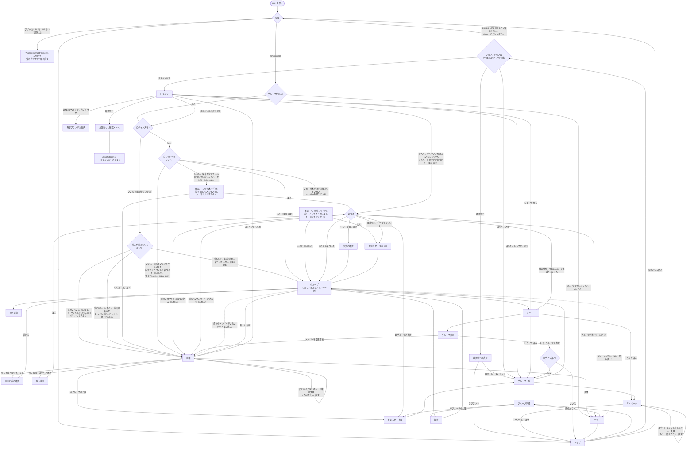

# 画面

状態：下書き（2026-10-23：グループを読めなかったときの文とボタン、ボット対策が読み込めないときの文を「API の応答と画面の動き」に足した。2026-10-23：閉じられないシートにも一番下のリンクとトップへを置くことを「画面のルール」に足した。2026-10-22：グループ作成と参加に添える使い道の文を「画面のルール」に足した。2026-10-22：グループIDの形が違う URL を開いたときの文を「API の応答と画面の動き」に足した。2026-10-16：地図データの出典を書く場所と文言を足した（ADR 0007）。2026-10-15：`/review-docs`（23件）を受けて、「API の応答と画面の動き」（`error` の値ごとの文・行き先・端末の記憶）を足し、参加とグループ作成に Turnstile、退会のログインし直しと失敗したときの案内、紐づけが 404 のときの矢印、グループ設定は `ownerOnly` で表示することを足した。2026-10-12：`/review-docs`（24件）を受けて、ログインの画面を節に分け、ワイヤーフレームの文言と例を直した。2026-10-12：要件IDの対応を付けるときに、モックから「グループの画面の中身」（地図、県の詳細、招待、ログイン）を書き出し、ワイヤーフレーム（draw.io）を作った。2026-10-12：Q-016・Q-017 の `/review-docs`（18件）を受けて、共用の端末で REQ-040 の紐づけの前に1回聞くこと、LINE ではアプリの画面すべてを外部ブラウザで開くこと、グループ一覧にマイページ、アカウントの入口の確認待ちと出口、立場ごとの出口の表、URL の守りを足した。2026-10-12：Q-016 を決めて、「トップと URL」の節（URL の一覧、トップと使い方の中身、アカウントの入口、招待URLを貼る欄）を足した。2026-10-12：Q-017 を決めて、ログアウト・退会のときは端末が覚えているメンバーを忘れないことにした。2026-10-11：Q-020 の `/review-docs`（21件）を受けて、遷移図をログインなし／ログイン済みと紐づけの分岐で書き直し、トップをログイン済みでも開ける入口にし、紐づけに失敗したとき、消されたことの気づき方（404 と部屋からの「取り直して」）、グループ設定の出し分け、失敗の文の分け方、参加の画面の出し分けを足した。2026-10-11：Q-020（画面遷移の抜け）をユーザーと決めて、メニュー、確認ダイアログ一式、操作の後に開く画面、知らせ（保存の失敗、いまは使えない、開いている画面で消されていたとき、リアルタイムが切れたとき、確認メールの待ち、REQ-039）、ログインの入口と戻り先、プライバシーポリシーと問い合わせの入口を足した。2026-10-10：同じ名前の確認と、10グループの上限のエラーを足した。2026-10-02：ログアウト、退会、退出、名前の変更、端末の名前の確認を要件定義の決定に合わせた）

> 2026-10-10 の注記：案 C（[ADR 0003](../adr/0003-backend-selection.md)）に決まったので、遷移図の「端末の枠」を「端末が覚えているメンバー」に直した

画面の配置は [ワイヤーフレーム](wireframes.drawio.svg)（draw.io。2026-10-12 に作った案）で示す。見た目と文言は Phase 3 で整える。ここでは、どの画面があり、どこからどこへ移り、何を知らせるかを書く。文言は案で、Phase 3 で画面を作るときに整える。立場の言葉（ログインなし、確認待ち、ログイン済み）は [用語集](../glossary.md) と [権限マトリクス](permissions.md) にそろえる。

## 画面一覧

| 画面 | 種類 | モック | 内容 |
|---|---|---|---|
| トップ | ページ | なし | 検索に出す素の HTML。アプリの説明、「グループを作る」、アカウントの入口、招待URLを貼る欄。ログイン済みでも開け、自動ではどこにも移らない。中身は下の「トップと URL」 |
| グループ作成 | シート | あり | グループ名と自分の名前。トップから開く。ログイン済みならグループ一覧からも開ける（REQ-001・REQ-032） |
| 参加 | シート | あり | 招待URLから開いたとき。グループ名と参加中のメンバーの名前を出し（REQ-002）、名前を入れてもらう。立場ごとの出し分けは下の「参加の画面」 |
| 招待 | シート | あり | 招待URLの表示とコピー |
| グループ（わたし／みんな／メンバー別） | ページ | あり | 地図と一覧。アプリの中心 |
| 県の詳細 | シート | あり | その県に誰が行ったか |
| メニュー | シート | なし | グループの画面のヘッダーから開く。中身は下の「メニューの中身」 |
| アカウントの入口 | ページ | なし | `/account`。トップの入口のボタンの行き先。開いたら最初に ID トークンを取り直してから分ける。ログインなしならログイン、ログイン済みならグループ一覧に、履歴に残さずに移る（`location.replace`。「戻る」で抜けられなくならないため）。確認待ちのときだけ、その場で確認待ちの表示を出す（下の「メニューの中身」） |
| ログイン | ページ | なし | 「ログイン／アカウントを作る」の切り替え、メール＋パスワード、Google、パスワードの再設定。入口はトップ（アカウントの入口）、メニュー、参加の3つ。LINE 以外のアプリ内ブラウザで開いたら、外部ブラウザの案内を出す（LINE は画面のルールのとおり自動で外部ブラウザに移る） |
| グループ一覧 | ページ | なし | ログイン済みのみ。参加中のグループ（自分のアカウントに紐づいたメンバーがいるもの）を切り替える。ここから新しいグループを作る。ヘッダーにマイページを置く（グループが0個でもマイページに行けるように）。端末が覚えている、まだ紐づいていないグループは出さない（招待URLから開けば紐づく。2026-10-12 にユーザーと決めた） |
| マイページ | ページ | なし | ログイン済みのみ（確認待ちの人は開けない）。アカウントの「行った」、メールアドレス、ログアウト、退会 |
| グループ設定 | シート | なし | 下の「グループ設定の中身」 |
| 確認ダイアログ | ダイアログ | なし | 退出、メンバーの削除、グループの削除、退会、合算、本人確認、同じ名前の確認。中身は下の「確認ダイアログ」 |
| お知らせ | ダイアログ | なし | OK を押すまで閉じないダイアログ。REQ-039、確認メール、10グループの上限 |
| 外部ブラウザの案内 | ページ | なし | ログインの画面を LINE 以外のアプリ内ブラウザで開いたとき（Google ログインが使えないため。NFR-002） |
| エラー | ページ | なし | グループが見つからない（削除された）、満員（20人）、通信エラー、いまは使えない（NFR-012）。「トップへ」のボタンを置く |
| 使い方 | ページ | なし | 検索に出す素の HTML（NFR-019）。下の「トップと URL」 |
| プライバシーポリシー | ページ | なし | 検索に出す素の HTML（NFR-008・NFR-019） |
| 問い合わせ | ページ | なし | 削除の依頼などのフォーム（NFR-018）。送り先はアプリの API |

アプリの画面はすべて、ヘッダーからトップへ戻れる（遷移図では省く）。

## 画面遷移図

- ログインした・メニューの「確認した」を押したときに開いていたグループは、いま入っていたメンバーを聞かずに紐づける（REQ-037。いま使っている本人なので）。それ以外で、端末が覚えている紐づいていないメンバーを使うときは、「この端末で『（名前）』として入っていました。あなたですか？」と1回聞く（REQ-040。共用の端末で、前に使った別の人のメンバーを紐づけないため。2026-10-12 にユーザーと決めた）。「いいえ」なら、そのメンバーを忘れる
- 参加の画面から来たときは、同じグループを開き直す（`IsLogin` に戻る）
- 本人確認と同じ名前の確認は、参加の画面の中で出す

**立場ごとの出口**（行き止まりがないかを確かめる表）：

| 立場 | ログアウト | 退会 | トップ |
|---|---|---|---|
| ログインなし | — | — | ヘッダー |
| 確認待ち | メニュー、アカウントの入口の確認待ちの表示 | できない（requirements の「分かっている限界」） | ヘッダー |
| ログイン済み（グループあり） | メニュー → マイページ、グループ一覧 → マイページ | マイページ | ヘッダー |
| ログイン済み（グループ0個） | トップ → アカウントの入口 → グループ一覧 → マイページ | マイページ | ヘッダー |

## グループの画面の中身

モックの画面を引き継ぐ（2026-10-12 に要件IDの対応を付けるときに書き出した。配置は [ワイヤーフレーム](wireframes.drawio.svg)）。

| 場所 | 中身 | 要件 |
|---|---|---|
| ヘッダー | グループ名、招待（招待のシートを開く）、メニュー（自分の名前のボタン）。グループを切り替えるボタンは置かない（ログイン済みはメニューのグループ一覧から） | REQ-003・REQ-026・REQ-032 |
| タブ | わたし／みんな／メンバー別 | REQ-016〜REQ-020 |
| まとめ | わたし：自分の行った県の数（「N / 47」）。みんな：誰かが行った県の数と、メンバーごとの行った県の数（多い順）。メンバー別：メンバーを選ぶボタンと、その人の行った県の数 | REQ-016・REQ-053・REQ-020 |
| 地図 | わたし：自分の「行った」を塗り、タップで付け外し。みんな：行った人が多い県ほど濃く塗り、全員まだの県を強調（切り替えられる）。メンバー別：選んだ人の「行った」だけ。県をタップすると県の詳細 | REQ-016〜REQ-020 |
| 色の凡例 | みんな：人数と濃さの対応。メンバー別：その人の色 | REQ-017・REQ-021 |
| 全員まだの県 | みんな：県の数と県名の一覧（タップで県の詳細）、「地図で強調」の切り替え。ないときは「全県だれかが行っています」 | REQ-054・REQ-018 |
| 地方ごとの一覧 | 地図の下に、県を地方ごとに並べる。地図と同じ操作ができる | REQ-055 |
| 一番下 | 「プライバシーポリシー・お問い合わせ」の小さなリンク。地図データの出典（下の「画面のルール」） | NFR-008 |

**県の詳細**（シート）：「N人中M人」と、行った人の名前（色付き）。全員まだなら旅行先の候補として勧める文。「自分も行ったことがある／自分の『行った』を外す」のボタン（REQ-019）。

**招待**（シート）：招待URLとコピーのボタン。スマホではシェアのボタン（Web Share API が使えるとき）も出す（REQ-002・REQ-003）。

## ログインの画面の中身

**ログイン**（ページ）：「ログイン／アカウントを作る」の切り替え、メール＋パスワード（作るときはパスワード8文字以上：REQ-059）、Google、パスワードの再設定（REQ-027〜REQ-029・REQ-058）。使っているメールアドレスで作ろうとしたときの文は REQ-058。

## 参加の画面

| | ログインなし・確認待ち | ログイン済み |
|---|---|---|
| グループ名と参加中のメンバーの名前（REQ-002） | ○ | ○ |
| 名前の入力 | ○ | ○ |
| 覚えていたメンバーが合わなかったとき | 「前回の名前が見つかりませんでした」（REQ-025） | —（ログイン済みは覚えている名前で入らない） |
| 覚えていたメンバーが紐づいていたとき | 「ログインしていた人はログインして入る」（REQ-025・REQ-035） | —（紐づけの「別のアカウントに紐づき済み」から来たときは「（名前）さんは、ほかのアカウントに紐づいています」） |
| 紐づいたメンバーと同じ名前を入れた（REQ-013） | 「この名前で入るにはログインが必要です」と、ログインへの入口 | 「この名前は、ほかのアカウントに紐づいています。別の名前を入れるか、そのアカウントでログインしてください」 |
| 紐づいていないメンバーと同じ名前を入れた | 同じ名前の確認（REQ-012） | 本人確認（REQ-043） |
| ログインへの入口 | ○（確認待ちには出さない） | — |
| ボット対策（Turnstile） | 「参加する」の上に置く。送るたびに新しいトークンを取る（1回しか使えないため。同じ名前の確認から戻ってやり直すときも取り直す） | 同じ |

グループ作成の画面にも、「作る」の上に同じボット対策を置く（Q-031）。

満員（20人）のグループでも、すでにいるメンバーの名前を入れたときは、満員ではなく同じ名前の確認・本人確認が出る（API が先に同じ名前を見る：[api](api.md)。人数は増えないので REQ-005 に反しない）。

## トップと URL

2026-10-12 にユーザーと決めた（Q-016）。トップ・使い方・プライバシーポリシーは検索に出す素の HTML、ほかはアプリの画面（React、`noindex`）にする（[architecture](architecture.md) の「検索に出すページと出さないページ」）。

| URL | 画面 | 種類 |
|---|---|---|
| `/` | トップ | 素の HTML（検索に出す） |
| `/guide` | 使い方 | 素の HTML（検索に出す） |
| `/privacy` | プライバシーポリシー | 素の HTML（検索に出す） |
| `/g/{groupId}` | グループ（参加） | アプリ |
| `/new` | グループ作成 | アプリ |
| `/account` | アカウントの入口 | アプリ |
| `/login` | ログイン | アプリ |
| `/groups` | グループ一覧 | アプリ |
| `/me` | マイページ | アプリ |
| `/contact` | 問い合わせ | アプリ |
| （確認メールとパスワードの再設定のリンク先） | 「確認が済みました。元の画面に戻ってください」など | Firebase が用意する画面を使うか、自前の画面（例：`/auth/action`）にするかは Phase 3 で決める（要確認） |

- アプリの URL を、ログイン済みでないのに `/groups`・`/me` で開いたとき、ログイン済みで `/login` を開いたときは、`/account` に履歴に残さずに移る
- ログインの後に戻る先は、URL に入れず `sessionStorage` に置く（グループIDが参照元やログに載らないため）

**トップの中身**（文面は Phase 2 でページを作るときに書く）：
- 一言の説明と、地図の画像
- 特徴3つ：登録なしで使える／みんなで地図を塗る／全員まだ行っていない県が分かる
- 使い方の3ステップ（作る → 招待する → 塗る）
- 「グループを作る」（`/new`）
- **アカウントの入口**：ボタンは1つで、行き先は `/account`。ボタンの文字だけを、アプリが端末に書いた「ログインの状態の目印」で変える（目印がなければ「ログイン」、確認待ちなら「メールの確認待ち」、ログイン済みなら「グループ一覧へ」）。トップでは Firebase を読み込まない（重くなり、ボタンがちらつくため）。目印は文字を変えるのに使うだけで、行き先の `/account` が本当のログインの状態で分けるので、目印が古くても間違った画面には入らない（2026-10-12 にユーザーと決めた）
- **招待URLを貼る欄**：小さく置く。貼られた文字からグループID（英数字22文字：[data-model](data-model.md) の `groups.id`）を取り出して `/g/{groupId}?openExternalBrowser=1` を開く。フォームで送らず、画面の中だけで取り出して移る（貼った文字がトップの URL やアクセス解析に載らないため）。グループIDの形でなければ「招待URLの形ではありません」と出す（リンクを PC でもらってスマホで開きたいときなどのため。2026-10-12 にユーザーと決めた）
- 下に、使い方・プライバシーポリシー・お問い合わせへのリンク

**使い方の中身**：作る → 招待する → 塗る の手順、ログインあり・なしの違い、よくある質問（名前を打ち間違えた、名前の入力をまた求められた（Safari で端末が覚えていたものが消えた）、グループを消したい、データを消してほしい）。

## メニューの中身

グループの画面のヘッダーから開く（モックの「自分の名前」のボタンの位置。配置はワイヤーフレームで決める）。

| 項目 | ログインなし | 確認待ち | ログイン済み |
|---|---|---|---|
| グループ設定 | ○ | ○ | ○ |
| ログイン | ○ | — | — |
| 確認待ちの表示（下） | — | ○ | — |
| グループ一覧、マイページ | — | — | ○ |
| トップ、プライバシーポリシー、問い合わせ | ○ | ○ | ○ |

**確認待ちの表示**（REQ-057。2026-10-11 にユーザーと決めた）：確認待ちの人は、API からはログインなしと同じに見え、アカウントの「行った」も読めない（[権限マトリクス](permissions.md)）。そのため、マイページとグループ一覧は開けず、メニューと、アカウントの入口（`/account`）に次だけを出す。

- 「メールの確認待ち（（メールアドレス）宛て）」
- 「確認メールを再送する」
- 「確認した」：ID トークンを取り直し、確認が済んでいれば、グループの画面なら開いているグループで端末が覚えているメンバーを聞かずに紐づけ、アカウントの入口ならグループ一覧に移る（[auth-flow](auth-flow.md) の 2. の「確認メールが済んだ後」）。済んでいなければ「まだ確認が済んでいません」
- 「ログアウト」：打ち間違えたアドレスで登録したときは、ここから正しいアドレスでやり直せる

画面に戻ってきたとき（別のアプリから切り替えたとき）も、ID トークンを取り直して同じように確かめる。

## グループ設定の中身

「作成者のみ」が効くのは、作成者のメンバーがいるときだけ（REQ-051）。

| 項目 | ログインなし | 確認待ち | ログイン済み |
|---|---|---|---|
| グループ名の変更、グループの削除、メンバーの削除 | 「誰でも」なら出す。「作成者のみ」なら出さず、「作成者だけが変えられます」と一言出す | ログインなしと同じ | 「誰でも」なら出す。「作成者のみ」なら、自分が作成者のメンバー（紐づいた本人）のときだけ出す |
| 管理できる人（誰でも／作成者のみ） | いまの設定を見せるだけ（API の `ownerOnly` で表示する。作成者がいなくなった後に `manageBy` を出すと「作成者のみ」と見えてしまうため：REQ-051） | いまの設定を見せるだけ（同じ） | 自分が作成者のメンバー（紐づいた本人）のときだけ切り替えられる（REQ-045）。ほかの人には見せるだけ |
| 退出 | ○ | ○ | ○ |
| 自分の名前の変更 | —（REQ-015） | — | ○（REQ-014） |
| メンバーを変更する（REQ-056） | ○ | —（使うと、確認が済んだ後に紐づける相手を忘れてしまうため） | — |

画面で出さないだけで、API と制約は [権限マトリクス](permissions.md) のとおりに断る。

## 確認ダイアログ

削除したものは戻せない（NFR-017）ので、消す操作は必ず確認する。消すボタンは赤にする。

| 操作 | 確認の中身 | 要件 |
|---|---|---|
| 退出 | 「（名前）として退出します。このグループでの『行った』は消えます。もう一度入るには招待URLが要ります［招待URLをコピー］」。ログイン済みなら「アカウントの『行った』は残ります」を足す。最後の1人なら「あなたが最後のメンバーです。グループも削除されます」（このときは作成者の注意は出さない）。最後の1人でない作成者のメンバーなら「このグループの作成者はいなくなり、戻せません」（「作成者のみ」なら「管理できる人は『誰でも』に変わります」も） | REQ-049〜REQ-051・REQ-039 |
| メンバーの削除 | 紐づいていないメンバー：「（名前）さんを削除します。その人のこのグループでの『行った』は消えます」。紐づいたメンバー：「（名前）さんを削除します。その人のアカウントの『行った』は残ります」。どちらも「招待URLを知っていれば、また参加できます」を足す。作成者のメンバーなら「このグループの作成者はいなくなり、戻せません」を足す（「誰でも」のときだけ起きる。「作成者のみ」では削除できるのは作成者だけで、自分は削除の一覧に出さないため）。自分は一覧に出さない（自分は「退出」を使う） | REQ-048・REQ-051 |
| グループの削除 | 「（グループ名）を削除します。全員（N人）のこのグループでの『行った』が消え、戻せません。ログインしているメンバーのアカウントの『行った』は残ります」。赤い「削除する」を押す（グループ名を打ち込ませるまではしない。2026-10-11 にユーザーと決めた） | REQ-047 |
| 退会 | 「アカウントとアカウントの『行った』を消します。紐づいた各グループからも退出します。取り消せません」と、紐づいたグループの一覧。最後の1人のグループには「グループも削除されます」、そうでない作成者のグループには「作成者がいなくなります」を添える（グループ一覧の API の `memberCount` と `isOwner` で分ける）。確認の後に、ログインし直してもらう（メール＋パスワードの人はパスワードの入力欄、Google の人は Google のログイン）。流れと失敗したときの案内は [auth-flow](auth-flow.md) の 5. | REQ-036・REQ-050・REQ-051 |
| 合算 | 「アカウントのデータを使う／合算する」。「アカウントのデータを使う」には「このグループでの入力は消えます」を添える | REQ-038 |
| 本人確認 | ログイン済みのとき：「この人はあなたですか？」 | REQ-043 |
| 同じ名前の確認 | ログインなしのとき：「（名前）さんはすでに参加しています。この人として続けますか？」（2026-10-10 に足した。モックは確かめずに入る） | REQ-012 |

「メンバーを変更する」（REQ-056）はメンバーを消さないので、確認を出さずに参加（名前の入力）に移る。

## 操作の後に開く画面

| 操作 | 開く画面 | 端末が覚えているメンバー |
|---|---|---|
| 退出、グループの削除 | ログイン済みならグループ一覧、ログインなしならトップ | そのグループのものを忘れる（忘れないと、次に開いたときに「前回の名前が見つかりませんでした」と出るため） |
| メンバーの削除（ほかの人） | グループ設定のまま | 変えない |
| ログアウト | トップ（REQ-034） | 忘れない（2026-10-12：Q-017。[auth-flow](auth-flow.md) の「端末が覚えるもの」） |
| 退会 | トップ（REQ-036） | 忘れない（同上） |
| ログイン、アカウントを作る | 来た画面に戻る。グループや参加の画面から来たなら、そのグループを開き直す（[auth-flow](auth-flow.md) の 3. の流れ）。トップから来たならグループ一覧 | — |
| メンバーを変更する | 参加（名前の入力） | そのグループのものを忘れる（REQ-056） |
| 開いたグループが見つからない | エラー | そのグループのものを忘れる |
| 紐づけが10グループの上限で断られた | お知らせ（下）のあと、グループ一覧 | 残す（ほかのグループから退出した後に開けば、紐づけられる：REQ-040） |
| 紐づけが「別のアカウントに紐づき済み」で断られた | 参加（名前の入力） | 忘れる（REQ-025 と同じ） |

## 知らせ

| 場面 | 出し方 | 要件 |
|---|---|---|
| 「行った」の付け外し | 押したら仮の表示（塗り）にして送る。応答が来るまで、その県はもう押せないようにする（続けて押したときや、応答の順番が入れ替わったときに食い違わないため）。成功したら確定。失敗したら最後に保存できた状態に戻す（2026-10-11 にユーザーと決めた：端末に溜めて送り直すことはしない）。送っている間に、ほかの人の変更がリアルタイムで届いたら、それも反映する | NFR-009 |
| やり直せる失敗（通信エラー、一時的な 503） | 「保存できませんでした。もう一度お試しください」。付け外しなら上のとおり元に戻す | NFR-009 |
| やり直しても通らない失敗（同じ名前がいる、権限がない、満員） | 理由の文を出し（「同じ名前の人がいます」「作成者だけが変えられます」など）、グループを読み直す（設定が途中で変わっていることがあるため） | NFR-009 |
| いまは使えない（無料枠を超えた） | API は 503 に理由を付けて返す（枠切れか、一時的な失敗か：[data-model](data-model.md)）。JSON でない応答（Cloudflare のエラー画面）も枠切れとみなす（[architecture](architecture.md)）。読み込みが止まったら、エラーの画面に「いまは混み合っていて使えません。遅くとも翌朝9時ごろには戻ります」。書き込みが止まったら、同じ文を出し、付け外しは元に戻す。Durable Objects の枠切れは、下の「リアルタイムの知らせがつながらない」と同じ扱い。無料枠を超えたときに API が実際にどんなエラーを返すか（D1・Workers・Durable Objects それぞれ）は Phase 2 で確かめる（要確認） | NFR-012 |
| ID トークンを取り直しても 401 になる（別の端末で退会した、など） | 「ログインし直してください」と出してログアウトし、トップを開く（ログインなしに落として続けない：[権限マトリクス](permissions.md)）。下の「API の応答と画面の動き」の `invalid_token` | NFR-006 |
| グループが削除されていた | 書き込みが 404、または部屋から「取り直して」が届いて読み直したら見つからない。「このグループは削除されました」と出し、エラーの画面に移る | REQ-006 |
| 自分のメンバーが削除されていた | 書き込みが 404、または読み直したら自分のメンバーがいない。「（名前）さんはグループから削除されました」と出し、覚えているメンバーを忘れて参加（名前の入力）に移る | REQ-048 |
| リアルタイムの知らせが数秒以上つながらない | 画面の上に細い帯で「自動で更新されていません［読み直す］」と出す。つながったら消す（会議の場では、画面が自動で変わる前提で見ているため）。つなぎ直す間隔はだんだん長くし（最大60秒）、続けて失敗してもつなぎ続けない（部屋への接続も Durable Objects の回数に数えるため。Q-031） | NFR-003 |
| アカウントを作った（メール＋パスワード） | お知らせ：「確認のメールを送りました。確認が済むまでは、ログインなしのままお使いいただけます」。以後はメニューとトップに確認待ちの表示 | REQ-057 |
| 確認待ちのまま、もう一度ログインした | お知らせ：「メールアドレスの確認が済んでいません」と「確認メールを再送する」 | REQ-057 |
| 開いたグループに、自分のアカウントのメンバーがすでにいた | お知らせで REQ-039 の文。1度出したら、覚えているメンバーを紐づいたメンバーに切り替え、次からは出さない | REQ-039 |
| 10グループの上限（参加、グループ作成、紐づけ） | お知らせ：「アカウントに紐づけられるのは10グループまでです。ほかのグループから退出すると、紐づけられます」。OK でグループ一覧に移る（2026-10-11 にユーザーと決めた）。紐づけで断られたグループは、紐づけられるまでログイン中は開けない（ログアウトすれば、ログインなしのメンバーとして使える） | REQ-060 |

## API の応答と画面の動き

API は、断るときに `error` の値を返す（[api](api.md)）。画面はこの値で文と行き先を決める。上の「知らせ」の場面と合わせて使う（2026-10-15：`/review-docs` #2・#11）。

| 状態コードと `error` | 返る API | 画面の文 | 行き先・端末が覚えているメンバー |
|---|---|---|---|
| `400 bad_name` | 作成、参加、名前の変更、グループ名の変更 | 入力欄の下に「1〜10文字（グループ名は20文字）で入れてください。見えない文字や一部の記号は使えません」 | その場で入れ直す |
| `400 bad_request`、`413 bad_request`、`404 not_found` | どれでも | 「保存できませんでした。もう一度お試しください」 | 画面の不具合なので、エラーの送信（Sentry）に送り、グループを読み直す |
| `401 invalid_token` | ログインが要る API、トークンを付けた API | まず ID トークンを取り直して1回だけ送り直す。それでも 401 なら「ログインし直してください」 | ログアウトしてトップ（上の「知らせ」） |
| `401 login_required` | ログインが要る API | 画面はログイン済みのつもりだが、API からはログインなし（確認待ちなど）に見えている。ID トークンを取り直して、ログインの状態（確認待ちの表示）を出し直す | 確認待ちなら、確認待ちの表示 |
| `403 turnstile_failed`（ボット対策の部品が読み込めない・解けないときも同じ：2026-10-23） | 作成、参加 | 「確認に失敗しました。もう一度お試しください」 | ボット対策を出し直して、その場でやり直す |
| `403 not_allowed` | 管理の操作、名前の変更 | 「作成者だけが変えられます」など（上の「やり直しても通らない失敗」） | グループを読み直す（設定が途中で変わっていることがあるため） |
| `403 member_linked` | ログインなしの「行った」の付け外し、退出 | 「（名前）さんはアカウントに紐づきました。ログインして入ってください」（ほかの端末で本人が紐づけた） | 覚えているメンバーを忘れて、参加（REQ-025 の「ログインしていた人はログインして入る」） |
| `403 member_linked` | 紐づけ | 「（名前）さんは、ほかのアカウントに紐づいています」 | 忘れて、参加（上の「操作の後に開く画面」） |
| `403 reauth_required` | 退会 | 「もう一度ログインし直してから、退会を押してください」 | マイページのまま、ログインし直しを出し直す |
| `404 group_not_found` | グループの中の API | 「このグループは削除されました」 | 忘れて、エラー（上の「知らせ」） |
| （API を呼ぶ前）`/g/` の後ろがグループIDの形（英数字22文字：data-model の `groups.id`）でない | — | 「グループが見つかりません。招待URLをもう一度確かめてください」（2026-10-22 にユーザーと決めた仮の文。Phase 3 で整える） | API を呼ばずにエラー。端末が覚えているものは変えない |
| `404 member_not_found` | 「行った」、名前の変更、紐づけ | 「（名前）さんはグループから削除されました」 | 忘れて、参加（上の「知らせ」） |
| `409 name_taken` | 参加 | `linked: false` なら同じ名前の確認・本人確認、`linked: true` なら参加の画面の文（REQ-012・REQ-013・REQ-043） | 参加のまま |
| `409 name_taken` | 名前の変更 | 「同じ名前の人がいます」 | その場で入れ直す |
| `409 already_member` | 参加 | 文は出さない（自分のメンバーがもういる） | グループを開き直す（REQ-041 で自分のメンバーとして開く） |
| `409 already_member` | 紐づけ | お知らせで REQ-039 の文 | 上の「知らせ」 |
| `409 group_full` | 参加 | 「このグループは満員（20人）です」 | エラー |
| `409 group_limit` | 作成、参加、紐づけ | 上の「10グループの上限」 | グループ一覧 |
| （グループを開くとき）通信エラー、`503 unavailable`（`reason: "temporary"`） | グループを開く | 「読み込めませんでした。もう一度お試しください」と「もう一度読み込む」のボタン（2026-10-23 にユーザーと決めた仮の文。枠切れ（`reason: "quota"`）は下の 503 のとおり） | その場で読み直す。端末が覚えているものは変えない |
| `429`（WAF のレート制限。JSON でないことがある） | どれでも | 「少し待ってから、もう一度お試しください」 | すぐには送り直さない（[architecture](architecture.md)） |
| `503 unavailable` | どれでも | `reason` で分ける（上の「やり直せる失敗」と「いまは使えない」） | 上の「知らせ」 |

## 画面のルール

- スマホ幅を基本にする（モックと同じ。PC でも崩れずに使える：NFR-001）
- アプリの画面（`/g/*` だけでなく、`/new`・`/account`・`/login` などすべて）を LINE のアプリ内ブラウザで開いたら、`?openExternalBrowser=1` を付けて外部ブラウザで開き直す（端末が覚えるものはブラウザごとに別なので、LINE の中で作ったグループを外部ブラウザが覚えていない、ということを防ぐ。2026-10-12 にユーザーと決めた：NFR-002）。検索に出すページ（トップ、使い方、プライバシーポリシー）は LINE の中でもそのまま読める。LINE 以外のアプリ内ブラウザでは自動で移せないので、ログインの画面で外部ブラウザの案内を出す
- ログインしていないとき（確認待ちを含む）は、グループ一覧とマイページには入れない
- 地図を出す画面（グループの画面）と、トップ・使い方の一番下に、地図データの出典を小さく書く：「地図：「国土数値情報（行政区域データ）」（国土交通省）を加工して作成」と、出典のページ（国土交通省国土数値情報ダウンロードサイト）へのリンク。地図データの約款（出典と加工したことを書く）を守るため（2026-10-16：[ADR 0007](../adr/0007-map-data-n03.md)、[NOTICE](../../NOTICE.md)）
- どの画面も、一番下に「プライバシーポリシー・お問い合わせ」の小さなリンクを置く（NFR-008 の「1回の操作で開ける」。地図の画面では一覧の下。メニューにも置く。2026-10-11 にユーザーと決めた）。OK を押すまで閉じないお知らせの間は押せないが、OK で閉じればすぐ押せるので、対象外とする
- 閉じられないシート（参加、グループ作成）は後ろの画面を覆うので、上の一番下のリンクと、トップへの出口をシートの中にも置く（2026-10-23。3-5 で作ったときに後ろのリンクが押せなくなっていた：[learnings](../learnings/2026-10-23-blocking-overlay-keeps-required-links.md)）
- 名前、メールアドレスを入れる画面（グループ作成、参加、ログイン、問い合わせ）には、入れたものの使い道を一言添える（NFR-008）。グループ作成：「グループ名とあなたの名前は、招待URLを知っている人に表示されます。本名でなくてもかまいません」。参加：「あなたの名前は、招待URLを知っている人に表示されます。本名でなくてもかまいません」（2026-10-22 にユーザーと決めた仮の文。参加の前にもグループ名と名前が見える REQ-002 に合わせて「メンバー」ではなく「招待URLを知っている人」にした。Phase 3 で整える）。ログインと問い合わせの文は、その画面を作るときに決める
