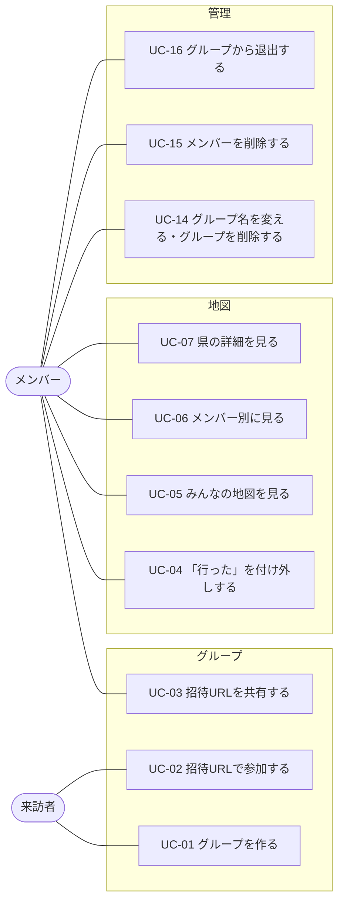

# ユースケース

状態：レビュー待ち（2026-11-09：UC-02 を、参加の画面で名前を選ぶか「新しく参加する」で名前を入れる流れにした（REQ-012・Q-035）。2026-11-06：ログインをやめた（[ADR 0013](adr/0013-drop-login.md)）。アクターの「メンバー（ログインあり）」「管理できる人」「作成者」と、UC-08〜UC-13・UC-17〜UC-19 を欠番にし、UC-01・UC-02・UC-04・UC-14〜UC-16 と「決定したこと」からログインと作成者のくだりを消した。2026-10-15：`/review-docs` を受けて、UC-01・UC-02・UC-19 の例外に使えない文字を足し、UC-02 の満員の扱いを API に合わせ、括弧の崩れを直した。それより前の経緯は git の履歴に残る）

「誰が何をするか」を洗い出した一覧。ここから機能要件（REQ-xxx）を起こした（[requirements.md](requirements.md) の各要件の「UC」の列が、このユースケースとの対応）。言葉は [用語集](glossary.md) にそろえる。

## アクター（登場する人）

| アクター | 説明 |
|---|---|
| 来訪者 | まだグループに入っていない人。招待URLを LINE などで受け取って開く |
| メンバー | 名前だけでグループに参加している人。会員登録はしない。グループの管理（UC-14・UC-15）も、メンバーなら誰でもできる |

2026-11-06 に、「メンバー（ログインあり）」「管理できる人」「作成者」のアクターをなくした（ログインをやめ、作成者だけの設定もなくしたため）。

## ユースケース図

図の読み方：形は UML と違う。丸い枠がアクター、四角がユースケース、枠（グループ・地図・管理）は分類。

## ユースケース一覧

| ID | 名前 | アクター | ゴール |
|---|---|---|---|
| UC-01 | グループを作る | 来訪者 | グループ名と自分の名前を入れて、グループと招待URLを得る |
| UC-02 | 招待URLで参加する | 来訪者 | 招待URLを開き、名前を入れてグループに入る |
| UC-03 | 招待URLを共有する | メンバー | 招待URLをコピーして LINE などで友達に送る |
| UC-04 | 「行った」を付け外しする | メンバー | 地図か一覧をタップして自分の「行った」を更新する |
| UC-05 | みんなの地図を見る | メンバー | 行った人が多い県と、全員まだ行っていない県を見て次の行き先の候補を見つける |
| UC-06 | メンバー別に見る | メンバー | 選んだ人の「行った」だけを見る |
| UC-07 | 県の詳細を見る | メンバー | 県をタップして、誰が行ったかを見る |
| UC-14 | グループ名を変える・グループを削除する | メンバー | グループ名の変更、グループの削除 |
| UC-15 | メンバーを削除する | メンバー | 他のメンバーをグループから外す |
| UC-16 | グループから退出する | メンバー | 自分のメンバーをグループから外す |

欠番（2026-11-06 にログインをやめたため：ADR 0013）：UC-08 ログインする、UC-09 「行った」を合算する、UC-10 本人確認して紐づける、UC-11 グループを切り替える、UC-12 マイページを見る・ログアウトする、UC-13 管理できる人を選ぶ、UC-17 アカウントを作る、UC-18 退会する、UC-19 自分の名前を変える。

## ユースケースの詳細

### UC-01 グループを作る
- 事前条件：なし
- 基本の流れ：トップで「グループを作る」→ グループ名と自分の名前を入力 → グループが作られ、最初のメンバーになる → 招待URLが表示される（UC-03）
- 例外：通信エラー → エラー画面／名前やグループ名に使えない文字（見えない文字など）が入っている → 入れ直してもらう（REQ-009・REQ-010）

### UC-02 招待URLで参加する
- 事前条件：招待URLを知っている
- 基本の流れ：URLを開く → 参加中のメンバーの名前が並ぶ → 初めてなら「新しく参加する」を押して名前を入力 → メンバーになり、グループの地図が開く
- 代替の流れ：
  - 端末に前回の名前が残っている → 端末が覚えているメンバーと名前が、グループの今のメンバーと合えば、参加の画面を出さずにそのまま開く。合わなければ（削除された）端末の名前を消し、「前回の名前が見つかりませんでした」と出して参加の画面へ。何をどこに覚えるかは [auth-flow](design/auth-flow.md) の「端末が覚えるもの」（Q-017）
  - 端末が覚えている名前をやめたい（打ち間違えて他人として入った、1台を何人かで使う）→「メンバーを変更する」で端末の名前を忘れ、参加の画面に戻る。メンバーは消さない（REQ-056）
  - すでにいるメンバー（スマホを替えた、覚えが消えた）→ 参加の画面で自分の名前をタップして入る。確かめは挟まない（REQ-012）
  - LINE のアプリ内ブラウザで開いた → 外部ブラウザに移る
- 例外：グループがない → エラー／満員（20人）→「新しく参加する」を出さず、新しくは参加できないと伝える（すでにいるメンバーは名前を選んで入れる）。送った後に満員と分かったとき（ほかの人が先に入った）はエラー／名前に使えない文字が入っている → 入れ直してもらう（REQ-009）
- 新しく参加で、同じ名前がすでにある場合（名前は1グループで重複させない）：「（名前）さんはもういます」と出し、そのメンバーとして入るボタンを添える。別の人なら名前を変える（2026-11-09。REQ-012）

### UC-03 招待URLを共有する
- 基本の流れ：招待の画面でURLをコピー（またはシェア）→ LINE に貼って送る
- 備考：再発行はしない（MVP）

### UC-04 「行った」を付け外しする
- 事前条件：メンバーである
- 基本の流れ：「わたし」で県をタップ（または一覧で選ぶ）→ 付け外しされ、保存される
- 備考：グループのメンバーごとに保存し、そのグループの誰でも編集できる。別のグループには引き継がない

### UC-05 みんなの地図を見る／UC-06 メンバー別に見る／UC-07 県の詳細を見る
- 「みんな」：行った人が多い県ほど濃く塗り、全員まだ行っていない県を強調する
- 「メンバー別」：選んだ1人の「行った」だけを表示する。メンバーの色は参加したときに自動で決まる（使われていない色から順に。足りなければ重複する）。色を変える操作はない（MVP）
- 県をタップ：その県に行った人の一覧を見る
- 備考：他の人の「行った」の付け外しは、画面を開いている人どうしで数秒以内に見える（NFR-003）。参加・退出は、画面を開き直したときに反映されればよい

### UC-14・UC-15 管理
- UC-14：グループ名の変更、グループの削除。メンバーなら誰でもできる。削除の前に、全員の「行った」が消えて戻せないことを確認する。削除した後はトップを開く（[screens](design/screens.md)。2026-10-11：Q-020）
- UC-15：メンバーの削除。メンバーなら誰でもできる。メンバーの名前の変更はない（REQ-015）

### UC-16 グループから退出する
- アクター：メンバー
- 事前条件：自分のメンバーである
- 流れ：グループ設定から「退出」→ 自分のメンバーがグループから消え、そのメンバーの「行った」も消える
- 代替の流れ：自分が最後のメンバー → 「あなたが最後のメンバーです。グループも削除されます」と確認し、グループも削除する
- 退出した後：トップを開き、端末が覚えているそのグループのメンバーを忘れる（[screens](design/screens.md)。2026-10-11：Q-020）
- 備考：本人を確かめられないので、名前で入れば誰でも退出させられる（2026-10-10 に Q-018 で決定）

## 決定したこと

- **すでにいるメンバーとして入るとき**（UC-02。Q-004 の「名前は重複させない」案で確定）：名前は1グループで重複させない。参加の画面で名前をタップして入る（信頼ベース。2026-11-09 に、名前を入れて「この人として続けますか？」と確かめる形から変えた）
- **名前の入力**（Q-003）：グループごとに名前を入れる
- **名前の変更**（Q-002・Q-004）：誰も変えられない。打ち間違えたら、退出して入り直す（2026-11-06 に、ログインした本人だけが変えられる決まりをなくした）
- **端末に残った名前が古いとき**（Q-002）：覚えているメンバーと名前が合えばそのまま開く。合わなければ参加の画面へ
- **メンバーの色**（Q-008）：参加したときに自動で割り当てる。変える操作はない（MVP）
- **退出したメンバーの「行った」**：グループから消す
- **メンバーが0人になったとき**（Q-007）：最後の1人が退出するときに確認し、グループも削除する
- **グループを削除したとき**：メンバーへの通知はしない
- **ログイン、作成者、管理できる人**：2026-11-06 にやめた（ADR 0013）。それまでの決定（Q-001 ログアウトした後、Q-005 複数のグループでログインしたとき、Q-006 退会、Q-009 作成者がログインしたとき、作成者の決め方、作成者がいなくなったとき、1つのアカウントに2つのメンバー）は git の履歴に残る

## 未決事項

[open-questions.md](open-questions.md) で管理する。このドキュメントに関わるもので残っているものはない（Q-010・Q-019 は暫定の決定、Q-011・Q-016・Q-017・Q-018・Q-020 は決定、Q-012 は取り下げ）。
